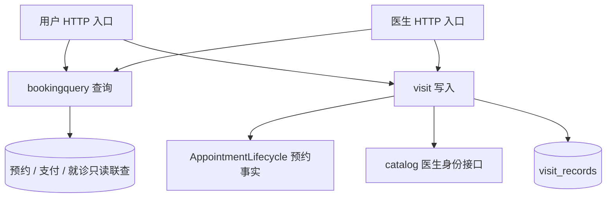

> 整理前正式文档的历史快照，检查点 `1e83c0c`。旧路径及代码步骤按当时理解；当前内容见[项目状态](../../../../docs/project-status.md)。

# 到院签到与门诊接诊设计

设计交付日期：2026-11-11；现行内容复核：2026-11-12。状态：已实现；源码包含 V10、就诊模块及本文接口。实际验证结果见 [验证报告](../../../../docs/verification-report.md)。

需求以 [spec.md](../summary.md) 为准；请求响应见 [API](../../../../docs/visit/api.md)，实施范围及前后变化见 [改动说明](../../../../docs/visit/change-scope.md)。既有行为以 [现行模块设计](../../../../docs/module-design.md) 和 ADR 0003、0004、0005 为基础；公共预约目录与截止规则现按 [ADR 0007](../../../../docs/adr/0007-three-day-booking-and-session-cutoffs.md) 执行。

阅读顺序：第 1–7 节说明总体设计；第 8 节将 API 对应到 Controller / Service；第 9–14 节给出迁移、业务方法、SQL、DTO 和既有文件的具体改造；第 15 节给出实施单元及验证。文中的 Java、SQL 用于说明实现，省略常规 import、访问器与错误映射；具体源码及验证记录为最终依据。

## 1. 模块分工与依赖

保持单 Spring Boot、单 Maven 和共享数据库。新增 `visit` 业务包，用户与医生看板共用就诊状态。

| 模块 | 本期职责 |
| --- | --- |
| `auth` / `user` | 沿用登录和 JWT；支持受控授予 `DOCTOR` 角色 |
| `catalog` | 医生档案新增登录账号关联；解析登录账号对应医生 |
| `appointment` | 保留预约、库存、快照、就诊序号；提供稳定预约事实 |
| `visit` | 签到、开始接诊、完成接诊，维护就诊记录 |
| `bookingquery` | 用户详情组合查询，以及医生概览、名单、详情只读查询 |
| `payment` / `coordination` | 保留既有收款、退款、预约确认和恢复职责 |



Controller 不访问 Mapper。`visit` 业务 Service 不依赖 `bookingquery`，不直接访问预约、支付或医生写 Mapper。查询模块允许只读联查业务表，不更新数据，也不因查看页面创建记录。

不为本期增加消息事件、消费者、定时任务、Redis 状态或通用工作流引擎。

## 2. 数据模型

### 2.1 医生账号

`doctors` 增加可空 `user_id`，关联已有账号并建立唯一约束：一个账号对应一个医生档案；现有医生在绑定前保留空值。继续复用现有 `roles` / `user_roles`，新增 `DOCTOR` 角色。

管理员绑定已有账号；普通注册继续只授予 `USER`。关联与授予角色在同一数据库事务中完成。首版不开发解绑、换绑和医生独立注册。用户授权后重新登录，现有 JWT 不动态变更角色。

### 2.2 就诊记录

已通过 Flyway 迁移 `V10__visit_workflow.sql` 新增 `visit_records`，未改写先前已执行的迁移。

| 字段 | 字段类型 | 约束及说明 |
| --- | --- | --- |
| `id` | BIGINT | 主键 |
| `appointment_order_id` | BIGINT | 非空、唯一，外键关联预约，保留历史不级联删除 |
| `status` | VARCHAR(32) | 非空，存储 `WAITING` / `IN_PROGRESS` / `COMPLETED` |
| `checked_in_at` | DATETIME | 非空，首次签到时创建记录 |
| `started_at` | DATETIME | 可空 |
| `completed_at` | DATETIME | 可空 |
| `created_at` | DATETIME | 非空 |
| `updated_at` | DATETIME | 非空 |

就诊记录不重复保存医院、科室、医生、就诊人快照或号码。就诊记录与预约一对一，通过预约定位场次和归属。

`NOT_CHECKED_IN` 是初始查询状态：仅当预约已确认且没有就诊记录时计算得出，不需要提前插入待签到记录。历史上没有记录仅说明系统没有记录该次签到，不证明实际未到院，不回填真实就诊结果。

## 3. 正常状态机与展示

| 事实 | 就诊记录 | 用户展示 |
| --- | --- | --- |
| 预约 `CONFIRMED`，无记录 | 不写库 | 已预约，待签到 |
| 用户签到 | 插入 `WAITING` 和签到时间 | 候诊中 |
| 医生开始接诊 | `WAITING` → `IN_PROGRESS`，保存开始时间 | 就诊中 |
| 医生完成接诊 | `IN_PROGRESS` → `COMPLETED`，保存完成时间 | 已就诊 |
| 其他预约状态 | 不生成待签到进度 | 保留原预约/支付展示 |

正常接诊不修改预约和支付状态。现有 `workflowStatus` 继续只表达预约与支付组合；用户端优先根据非空 `visit.status` 展示就诊文案，否则使用原流程展示。

共享 `VisitRules` 是小型纯规则类，不再增加 interface：

- 已确认、就诊日期等于服务端今天、无签到记录：允许签到。
- `WAITING`：允许开始接诊。
- `IN_PROGRESS`：允许完成接诊。

正常操作由医生一位一位接诊。本期不引入跨行忙碌状态、强制队首规则或精确到分钟的开诊资格。按钮矩阵只按当前行就诊状态计算；身份与归属在对应写入口确认。

签到按上海日期判断整天资格，不校验场次起止；医生动作没有额外的当天或场次时间要求。未签到、未完成记录不会被时钟推进自动改写。

全部业务时间复用现有 `appointmentClock`（`Asia/Shanghai`）。一次列表统一采样时间，查询标记与写入共用同样的日期规则；写入时重新判断正常操作资格。

## 4. Service 契约

以下是已实现的接口形状。接口返回 DTO 或稳定业务事实，不返回 Entity。

### 4.1 用户预约查询：扩展已有契约

```java
public interface AppointmentService {
    // 保留旧签名，使用默认 DESC，兼容已有调用者。
    List<AppointmentResponse> listMine(Long userId);

    List<AppointmentResponse> listMine(
            Long userId, AppointmentTimeOrder order);

    AppointmentResponse getOwned(Long userId, Long appointmentId);
}

public enum AppointmentTimeOrder { ASC, DESC }
```

仍由 `bookingquery.application.DefaultBookingQueryService` 实现。旧签名保留，但默认列表顺序有意从 ID 降序调整为就诊日期、开始时间、ID 降序；兼容影响见改动说明。Mapper 使用两个固定排序分支，不拼接客户端传入的 SQL。

### 4.2 就诊写入：新增 `VisitService`

```java
public interface VisitService {
    void checkIn(Long userId, Long appointmentId);
    void startVisit(Long doctorUserId, Long appointmentId);
    void completeVisit(Long doctorUserId, Long appointmentId);
}
```

| 方法 | 正常执行步骤 |
| --- | --- |
| `checkIn` | 读取预约事实 → 确认账号归属、已确认、当天、待签到 → 插入候诊记录和时间 |
| `startVisit` | 解析医生身份 → 确认预约所属医生、候诊状态 → 更新就诊中和开始时间 |
| `completeVisit` | 解析医生身份 → 确认预约所属医生、就诊中状态 → 更新已就诊和完成时间 |

三个方法由 `DefaultVisitService` 实现，分别使用普通 `@Transactional` 同步提交。它们只写就诊表，不调用释放库存或取消退款方法。

预约事实通过 `AppointmentLifecycle.find()`读取。`AppointmentLifecycleCase`已包含`doctorId`，由`DefaultAppointmentLifecycle`从预约快照映射，生产构造点和测试数据已同步。该字段只用于归属校验，不授予预约生命周期写入权限。

### 4.3 医生只读查询

```java
public interface DoctorVisitQueryService {
    List<DoctorSessionResponse> listSessions(
            Long doctorUserId, LocalDate date);

    List<DoctorAppointmentRowResponse> listAppointments(
            Long doctorUserId, LocalDate date,
            AppointmentSession sessionType);

    DoctorAppointmentDetailResponse getAppointment(
            Long doctorUserId, Long appointmentId);
}
```

实现归属 `bookingquery`。查询先从登录身份解析医生 ID，再限定该医生的数据；不接受客户端任意指定医生。

概览组合固定四场和实际预约统计，不要求场次行预先存在。名单只读已确认预约及其就诊进度，按 `visit_number ASC`；不按状态或签到时间重排。详情从预约快照获取资料，证件号在响应组装时脱敏。

### 4.4 医生身份准备

`catalog.service.DoctorAccountService`已实现以下契约：

```java
DoctorAccountResponse bindAccount(Long doctorId, Long userId);
Long requireDoctorId(Long userId);
```

绑定方法作为同库事务入口，写本模块医生关联，通过 `user` 模块新增的内部 `UserRoleService.grantDoctorRole(userId)` 确认账号并授予角色；不跨模块访问用户 Mapper。`requireDoctorId` 供 `visit` 和医生查询使用，仅返回 ID。

这两个职责分别留在医生档案和用户角色的拥有模块，不迁移既有医生目录或身份数据。

## 5. HTTP 与查询组装

### 5.1 签到入口

`visit.controller.UserVisitController` 映射 `/api/v1/appointments/{appointmentId}/check-in`。URL 使用预约标识，不要求 Controller 放进预约业务包。

```java
Long userId = (Long) authentication.getPrincipal();
visitService.checkIn(userId, appointmentId);
return Result.success(appointmentService.getOwned(userId, appointmentId));
```

签到事务提交后，HTTP 入口查询最新详情返回；`VisitService` 本身不反向调用页面查询。用户不提交账号 ID、状态或签到时间。

### 5.2 用户返回结构

现有 `AppointmentResponse` 增加可空 `AppointmentVisitResponse visit`，并补充可空 `sessionType` 供页面显示场次标签。新响应类型放在 `appointment.dto`，仅持有 String、时间和布尔值，避免预约契约反向依赖 `visit` 实现。

```java
public record AppointmentVisitResponse(
        String status,
        LocalDateTime checkedInAt,
        LocalDateTime startedAt,
        LocalDateTime completedAt,
        boolean canCheckIn) {}
```

`BookingQueryMapper` 增加对 `visit_records` 的 LEFT JOIN，并读取关联场次的 `session_type`；`BookingQueryRecord` 增加相应字段，`AppointmentResponseAssembler` 结合预约状态与统一时间组装上述对象。日期和起止时间仍取预约快照，历史空或旧场次类型继续可读。已有取消接口返回 `AppointmentResponse`，因此也带上新增字段；创建接口使用独立的 `AppointmentCreationResult`，响应结构保持原样。

医生详情使用自己的 DTO，只有预约与就诊所需资料，不复用携带支付渠道摘要的用户完整响应。医生开始/完成返回更新后的医生详情，前端随后重新查询名单，更新按钮与统计。

## 6. 代码组织

```text
com.qsx.appoint/
catalog/
  controller/DoctorAccountController.java
  dto/BindDoctorAccountRequest.java
  dto/DoctorAccountResponse.java
  service/DoctorAccountService.java
  service/impl/DoctorAccountServiceImpl.java
  entity/Doctor.java                         [修改]
  mapper/DoctorMapper.java                   [修改]

user/
  service/UserRoleService.java
  service/impl/UserRoleServiceImpl.java

appointment/
  controller/AppointmentController.java      [修改]
  service/AppointmentService.java            [修改]
  application/AppointmentLifecycleCase.java  [修改]
  application/DefaultAppointmentLifecycle.java [修改]
  dto/AppointmentTimeOrder.java
  dto/AppointmentVisitResponse.java
  dto/AppointmentResponse.java               [修改]

visit/
  controller/UserVisitController.java
  controller/DoctorVisitController.java
  application/VisitService.java
  application/DefaultVisitService.java
  domain/VisitStatus.java
  domain/VisitRules.java
  entity/VisitRecord.java
  mapper/VisitRecordMapper.java

bookingquery/
  application/DoctorVisitQueryService.java
  application/DefaultDoctorVisitQueryService.java
  application/DoctorVisitResponseAssembler.java
  application/DefaultBookingQueryService.java [修改]
  application/AppointmentResponseAssembler.java [修改]
  persistence/DoctorVisitQueryMapper.java
  persistence/DoctorVisitQueryRecord.java
  persistence/DoctorSessionCountRecord.java
  persistence/BookingQueryMapper.java         [修改]
  persistence/BookingQueryRecord.java         [修改]
  dto/DoctorSessionResponse.java
  dto/DoctorAppointmentRowResponse.java
  dto/DoctorAppointmentDetailResponse.java
  dto/DoctorPatientResponse.java
  dto/DoctorVisitProgressResponse.java
```

上面均为根包下的相对位置，无标记项为本次新增。DTO、Entity、Mapper 沿用项目的命名习惯；不增加 Maven 子工程。

继续复用现有用户查询组装，不为用户端再建一套查询 Service。医生查询使用一个内部 `DoctorVisitResponseAssembler` 集中转换快照与脱敏字段；它是普通类，不再为它增加接口。

## 7. 设计约束与验证方向

- 预约库存、快照、号码、防重复占用继续由预约模块拥有。
- 查询不写库；写 Service 不依赖 `bookingquery` 或其他模块持久化对象。
- 正常状态变化由三个明确动作完成，不提供通用“修改状态”接口。
- 架构检查已覆盖新 `visit` 写模块和医生只读 Mapper。
- 使用受控 Clock 验证当天签到规则，以正常用户/医生 HTTP 链路验收双方状态一致；实测结果见改动说明与验证报告。

本设计细化现有模块化单体，不改变 ADR 0003 的库存与号码、ADR 0004 的支付协作、ADR 0005 的四场按需生成规则。

## 8. API 到 Controller / Service 的实施映射

所有路径以 `/api/v1` 为前缀。已有接口具体请求响应保留 [API 文档](../../../../docs/visit/api.md) 的约定。

| API | Controller 方法 | 调用的 Service | 返回 data |
| --- | --- | --- | --- |
| `GET /appointments/my` | `AppointmentController.mine` | `AppointmentService.listMine(userId, order)` | `List<AppointmentResponse>` |
| `GET /appointments/{id}` | `AppointmentController.get` | `AppointmentService.getOwned(userId, id)` | `AppointmentResponse` |
| `POST /appointments/{id}/check-in` | `UserVisitController.checkIn` | `VisitService.checkIn`，成功后 `AppointmentService.getOwned` | 更新后的 `AppointmentResponse` |
| `PUT /admin/doctors/{id}/account` | `DoctorAccountController.bindAccount` | `DoctorAccountService.bindAccount` | `DoctorAccountResponse` |
| `GET /doctor/sessions` | `DoctorVisitController.listSessions` | `DoctorVisitQueryService.listSessions` | `List<DoctorSessionResponse>` |
| `GET /doctor/appointments` | `DoctorVisitController.listAppointments` | `DoctorVisitQueryService.listAppointments` | `List<DoctorAppointmentRowResponse>` |
| `GET /doctor/appointments/{id}` | `DoctorVisitController.getAppointment` | `DoctorVisitQueryService.getAppointment` | `DoctorAppointmentDetailResponse` |
| `POST /doctor/appointments/{id}/start-visit` | `DoctorVisitController.startVisit` | `VisitService.startVisit`，成功后医生详情查询 | 更新后的医生详情 |
| `POST /doctor/appointments/{id}/complete-visit` | `DoctorVisitController.completeVisit` | `VisitService.completeVisit`，成功后医生详情查询 | 更新后的医生详情 |

Controller 统一返回 `Result.success(data)`。三种动作接口不接收请求体，身份来自现有 `Authentication` 的 Long principal。

管理员 Controller 使用 `@PreAuthorize("hasRole('ADMIN')")`，医生 Controller 使用 `@PreAuthorize("hasRole('DOCTOR')")`；用户入口复用现有登录要求，再由业务方法确认预约归属。`SecurityConfig` 已启用方法权限，沿用该机制。

医生日期概览的 `date` 可空，由查询 Service 使用业务 Clock 补成今天；名单的 `date`、`sessionType` 必填。场次参数可在 Controller 调用现有 `AppointmentSession.require(raw)` 转换，避免在 HTTP 层和业务层重复定义四场枚举。

已有用户列表新增 `@RequestParam(defaultValue = "DESC") AppointmentTimeOrder order`。保留原详情方法、创建方法和取消方法的动作职责。

## 9. 迁移与持久化实现

### 9.1 V10 迁移中的核心 SQL

下面是新增的 MySQL 结构，版本为 V10。新增两个普通查询索引，保留既有索引；H2 与 MySQL 的迁移适配按项目已有测试配置验证。

```sql
ALTER TABLE doctors ADD COLUMN user_id BIGINT;
ALTER TABLE doctors ADD CONSTRAINT uk_doctors_user UNIQUE (user_id);
ALTER TABLE doctors ADD CONSTRAINT fk_doctors_user
    FOREIGN KEY (user_id) REFERENCES users (id);

INSERT INTO roles (code, name) VALUES ('DOCTOR', '医生');

CREATE TABLE visit_records (
    id BIGINT AUTO_INCREMENT PRIMARY KEY,
    appointment_order_id BIGINT NOT NULL,
    status VARCHAR(32) NOT NULL,
    checked_in_at DATETIME NOT NULL,
    started_at DATETIME,
    completed_at DATETIME,
    created_at DATETIME NOT NULL DEFAULT CURRENT_TIMESTAMP,
    updated_at DATETIME NOT NULL DEFAULT CURRENT_TIMESTAMP,
    CONSTRAINT uk_visit_records_appointment UNIQUE (appointment_order_id),
    CONSTRAINT fk_visit_records_appointment
        FOREIGN KEY (appointment_order_id) REFERENCES appointment_orders (id),
    CONSTRAINT ck_visit_records_status
        CHECK (status IN ('WAITING', 'IN_PROGRESS', 'COMPLETED'))
);

CREATE INDEX idx_appointments_user_visit_time
    ON appointment_orders (user_id, appointment_date, start_time, id);
CREATE INDEX idx_appointments_doctor_visit_date
    ON appointment_orders (doctor_id, appointment_date, status, schedule_id, visit_number);
```

这些操作只扩展结构。不给既有医生自动分配账号，不生成历史就诊记录，不改变预约状态约束，不初始化新的号源。

### 9.2 Entity 与 Mapper

`Doctor` 增加 `Long userId`。`VisitRecord` 使用 `@TableName("visit_records")`，字段与第 2 节对应；ID 使用显式 `@TableId(type = IdType.AUTO)`，与新表自增主键一致。Java 层实体状态保持 String，业务判断使用 `VisitStatus`。

```java
public enum VisitStatus {
    NOT_CHECKED_IN,
    WAITING,
    IN_PROGRESS,
    COMPLETED
}

public interface VisitRecordMapper extends BaseMapper<VisitRecord> {
    VisitRecord selectByAppointmentOrderId(Long appointmentId);
    int startIfWaiting(Long appointmentId, LocalDateTime now);
    int completeIfInProgress(Long appointmentId, LocalDateTime now);
}
```

自定义方法使用静态 SQL，接口标注 `@Mapper`，参数沿用现有 `@Param` 风格；`appointmentId`、`now` 的参数名与 SQL 占位符一致。关键两条写语句为：

```sql
UPDATE visit_records
SET status = 'IN_PROGRESS', started_at = #{now}, updated_at = #{now}
WHERE appointment_order_id = #{appointmentId} AND status = 'WAITING';

UPDATE visit_records
SET status = 'COMPLETED', completed_at = #{now}, updated_at = #{now}
WHERE appointment_order_id = #{appointmentId} AND status = 'IN_PROGRESS';
```

状态前置条件直接体现在 UPDATE 中，正常执行要求影响一行。原时间字段保持，完成操作不会覆盖签到和开始时间。签到插入时，由应用统一设置 `checkedInAt`、`createdAt`、`updatedAt`，与业务 Clock 保持一致。

## 10. 三个业务方法的具体实现步骤

### 10.1 依赖注入与规则

`DefaultVisitService` 只注入：

```text
AppointmentLifecycle      读取预约事实
DoctorAccountService      将医生登录账号解析为医生 ID
VisitRecordMapper         读写本模块就诊表
Clock appointmentClock    统一业务时间
```

共享规则只接收事实，不读取数据库或 Clock：

```java
public final class VisitRules {
    private VisitRules() {}

    public static boolean canCheckIn(
            AppointmentStatus appointmentStatus,
            LocalDate appointmentDate,
            VisitStatus progress,
            LocalDate today) {
        return appointmentStatus == AppointmentStatus.CONFIRMED
                && appointmentDate.equals(today)
                && progress == VisitStatus.NOT_CHECKED_IN;
    }

    public static boolean canStart(VisitStatus progress) {
        return progress == VisitStatus.WAITING;
    }

    public static boolean canComplete(VisitStatus progress) {
        return progress == VisitStatus.IN_PROGRESS;
    }
}
```

读取状态时，已确认预约的空就诊记录转换成 `NOT_CHECKED_IN`；有记录则转换其已保存状态。非已确认预约的用户响应直接返回 `visit=null`，不进入这个初始状态转换。

### 10.2 `checkIn(userId, appointmentId)`

1. 调用 `appointmentLifecycle.find(appointmentId)` 取得稳定预约事实。
2. 确认存在且 `appointment.userId()` 与登录用户一致。
3. 查询本模块记录，得出当前进度。
4. 采样一次秒精度 `now`，用 `now.toLocalDate()` 判断当天资格。
5. 确认 `VisitRules.canCheckIn(...)`，插入 `WAITING` 记录。
6. 提交事务，HTTP 层查询原预约详情返回。

关键写入代码示意：

```java
LocalDateTime now = LocalDateTime.now(appointmentClock)
        .truncatedTo(ChronoUnit.SECONDS);

VisitRecord record = new VisitRecord();
record.setAppointmentOrderId(appointmentId);
record.setStatus(VisitStatus.WAITING.name());
record.setCheckedInAt(now);
record.setCreatedAt(now);
record.setUpdatedAt(now);
visitRecordMapper.insert(record);
```

普通查询不创建记录；只有这个方法首次插入。没有调用预约确认、号码分配、支付或库存方法。

### 10.3 `startVisit(doctorUserId, appointmentId)`

1. 调用 `doctorAccountService.requireDoctorId(doctorUserId)`。
2. 读取预约事实，确认预约已确认且 `appointment.doctorId()` 为当前医生。
3. 读取就诊记录，确认当前为 `WAITING`。
4. 采样业务时间，调用 `startIfWaiting(appointmentId, now)`，正常影响一行。
5. 提交后由 HTTP 层查询更新后的医生详情。

### 10.4 `completeVisit(doctorUserId, appointmentId)`

1. 解析医生身份，读取并确认预约归属。
2. 确认已确认预约对应的进度为 `IN_PROGRESS`。
3. 采样业务时间，调用 `completeIfInProgress(appointmentId, now)`。
4. 提交后由 HTTP 层返回更新后的医生详情。

开始和完成方法共用私有 `requireDoctorAppointment(doctorUserId, appointmentId)` 归属检查，避免重复实现。其余步骤直接写在业务方法中，不增加命令总线、事件分发或通用状态机类。

## 11. 医生账号关联的具体实现

`DoctorAccountServiceImpl` 放在 `catalog.service.impl`，注入 `DoctorMapper` 和 `UserRoleService`。`UserRoleServiceImpl` 放在 `user.service.impl`，仅访问本模块 `UserMapper`、`RoleMapper`、`UserRoleMapper`。

| 方法 | 正常执行逻辑 |
| --- | --- |
| `bindAccount(doctorId, userId)` | 读取医生 → 确认账号可首次关联 → 调用角色授予 → 保存医生的 userId → 返回两个 ID |
| `requireDoctorId(userId)` | 按 doctors.user_id 查询，返回医生 ID，不返回 Doctor Entity |
| `grantDoctorRole(userId)` | 确认账号存在 → 查 DOCTOR 角色 → 在原角色基础上增加 user_roles 关联 |

角色授予保留 USER、ADMIN 等已有角色，不用一份新角色列表覆盖旧关联。若账号已具有 DOCTOR，只保留已有角色关联，不重复插入；这里不扩展异常恢复机制。

`bindAccount` 使用 `@Transactional`，内部角色方法使用默认事务传播加入同库事务，不使用 `REQUIRES_NEW`。完成后关联与角色一起提交，现有登录自动读取角色，无需修改 JWT 格式。

`DoctorMapper` 增加 `Doctor selectByUserId(Long userId)` 和 `int bindAccountIfUnbound(Long doctorId, Long userId)`，参数均使用同名 `@Param`。首次绑定 SQL 为 `UPDATE doctors SET user_id = #{userId} WHERE id = #{doctorId} AND user_id IS NULL`，正常影响一行。请求 DTO 为 `BindDoctorAccountRequest(@NotNull Long userId)`，响应为 `DoctorAccountResponse(Long doctorId, Long userId)`。

## 12. 查询 SQL 与组装算法

### 12.1 用户列表、详情

现有 `BookingQueryMapper.PROJECTION` 增加：

```sql
s.session_type,
v.id AS visit_record_id,
v.status AS visit_status,
v.checked_in_at,
v.started_at,
v.completed_at
```

在已有 FROM / JOIN 后加入：

```sql
LEFT JOIN visit_records v ON v.appointment_order_id = a.id
```

`status` 仍是预约状态，`visit_status` 单独命名，避免混淆。`BookingQueryRecord` 对应增加 `String sessionType`、`Long visitRecordId`、`String visitStatus` 和三个时间字段。

列表 Mapper 保留 `selectByUserId(userId)` 作为默认 DESC 的旧入口，增加 `selectByUserIdAsc(userId)`。两条固定排序分别为：

```sql
ORDER BY a.appointment_date DESC, a.start_time DESC, a.id DESC
```

```sql
ORDER BY a.appointment_date ASC, a.start_time ASC, a.id ASC
```

`DefaultBookingQueryService.listMine(userId, order)` 选择对应查询，整个列表继续使用同一次 `serverTime`。原 `listMine(userId)` 委托新方法，传入 DESC。

`AppointmentResponseAssembler` 在原支付关联检查和 workflow 投影之后组装 `visit`：

```text
预约不是 CONFIRMED
    → visit = null

预约是 CONFIRMED，没有就诊记录
    → status = NOT_CHECKED_IN，三个时间为空
    → 用共享规则计算 canCheckIn

预约是 CONFIRMED，有就诊记录
    → 读取保存的状态与时间
    → canCheckIn = false
```

同一详情继续返回原 canPay、canCancel，原 workflow 计算不加入新的状态分支；前端根据非空 visit 优先展示就诊进度。

### 12.2 医生名单与详情

新增 `DoctorVisitQueryMapper` 只声明 SELECT，不继承 BaseMapper。方法：

```java
List<DoctorSessionCountRecord> countByDoctorAndDate(
        Long doctorId, LocalDate date);

List<DoctorVisitQueryRecord> selectByDoctorDateSession(
        Long doctorId, LocalDate date, String sessionType);

DoctorVisitQueryRecord selectOwnedDetail(
        Long doctorId, Long appointmentId);
```

名单的核心查询范围：

```sql
SELECT a.id AS appointment_id, a.visit_number, a.patient_name,
       v.status AS visit_status, v.checked_in_at
FROM appointment_orders a
JOIN schedules s ON s.id = a.schedule_id
LEFT JOIN visit_records v ON v.appointment_order_id = a.id
WHERE a.doctor_id = #{doctorId}
  AND a.appointment_date = #{date}
  AND s.session_type = #{sessionType}
  AND a.status = 'CONFIRMED'
ORDER BY a.visit_number ASC
```

详情采用同样的预约和就诊关联，查询条件为 `a.id = #{appointmentId} AND a.doctor_id = #{doctorId} AND a.status = 'CONFIRMED'`，额外选择第 13 节 DTO 所需快照字段、三个时间和场次类型。

资料来自预约快照，不从当前医生、就诊人资料反向覆盖。名单和详情共用内部组合行类型 `DoctorVisitQueryRecord`，名单与详情使用相同快照投影，但 HTTP 名单只输出所需字段；内部组合行不直接返回 HTTP。

`DoctorVisitResponseAssembler` 使用 `VisitStatus` 判断按钮，使用现有 `ResidentIdCard.mask(...)` 处理详情证件号：

```text
无就诊记录 → NOT_CHECKED_IN
canStartVisit    = VisitRules.canStart(progress)
canCompleteVisit = VisitRules.canComplete(progress)
查看始终可用，不返回 canView
```

### 12.3 医生四场概览

一次聚合读取已有预约人数，再由 Java 补齐固定四场：

```sql
SELECT s.session_type,
       COUNT(*) AS confirmed_count,
       SUM(CASE WHEN v.id IS NULL THEN 1 ELSE 0 END) AS not_checked_in_count,
       SUM(CASE WHEN v.status = 'WAITING' THEN 1 ELSE 0 END) AS waiting_count,
       SUM(CASE WHEN v.status = 'IN_PROGRESS' THEN 1 ELSE 0 END) AS in_progress_count,
       SUM(CASE WHEN v.status = 'COMPLETED' THEN 1 ELSE 0 END) AS completed_count
FROM appointment_orders a
JOIN schedules s ON s.id = a.schedule_id
LEFT JOIN visit_records v ON v.appointment_order_id = a.id
WHERE a.doctor_id = #{doctorId}
  AND a.appointment_date = #{date}
  AND a.status = 'CONFIRMED'
  AND s.session_type IN (
      'MORNING_FIRST', 'MORNING_SECOND', 'AFTERNOON_FIRST', 'AFTERNOON_SECOND')
GROUP BY s.session_type
```

`listSessions` 按以下步骤组装：解析医生 ID → 默认日期补今天 → 查询聚合结果并按类型建 Map → 按 `AppointmentSession.values()` 顺序遍历 → 使用枚举起止时间构造四项，缺失项填零。

不使用今天至后天的公共可预约目录代替医生当天查询；医生看板和名单不因新下单截止而隐藏已确认预约，也不生成空场次。就诊表一对一约束保证聚合不会因关联产生重复计数。

## 13. 返回 DTO 与字段来源

### 13.1 医生端 DTO

```java
public record DoctorSessionResponse(
        LocalDate appointmentDate,
        String sessionType,
        LocalTime startTime,
        LocalTime endTime,
        int confirmedCount,
        int notCheckedInCount,
        int waitingCount,
        int inProgressCount,
        int completedCount) {}

public record DoctorAppointmentRowResponse(
        Long appointmentId,
        Integer visitNumber,
        String patientName,
        String visitStatus,
        LocalDateTime checkedInAt,
        boolean canStartVisit,
        boolean canCompleteVisit) {}

public record DoctorVisitProgressResponse(
        String status,
        LocalDateTime checkedInAt,
        LocalDateTime startedAt,
        LocalDateTime completedAt) {}

public record DoctorPatientResponse(
        Long id,
        String name,
        String documentType,
        String documentNoMasked) {}

public record DoctorAppointmentDetailResponse(
        Long appointmentId,
        String appointmentNo,
        Integer visitNumber,
        LocalDate appointmentDate,
        String sessionType,
        LocalTime startTime,
        LocalTime endTime,
        DoctorPatientResponse patient,
        AppointmentDoctorResponse doctor,
        DoctorVisitProgressResponse visit) {}
```

详情复用已有 `AppointmentDoctorResponse` 及其医院、科室快照 DTO。就诊人使用精简 DTO，不携带用户详情中的联系方式或支付信息。

DTO 的 ID 使用 Long，以复用项目现有字符串 ID 序列化；人数使用 int，保持 API 中的 JSON 数字。当前聚合行和人数 DTO 均使用 int，避免计数被 Long 序列化器输出为字符串。

### 13.2 字段来源对照

| 页面字段 | 数据来源 | 组装位置 |
| --- | --- | --- |
| 医院、科室、医生、就诊人 | appointment_orders 快照 | 用户原 Assembler / 医生 Assembler |
| 日期、起止时间、号码、预约单号 | appointment_orders | 对应查询组合行 |
| 场次标签 | schedules.session_type | 读取类型，前端映射中文 |
| 待签到进度 | 已确认预约且无 visit_records | 对应 Assembler 计算 |
| 候诊、就诊中、已就诊、三个时间 | visit_records | 对应 Assembler |
| 用户签到按钮 | VisitRules + 统一业务日期 | 用户 Assembler |
| 医生开始、完成按钮 | VisitRules + 当前行状态 | 医生 Assembler |
| 四场时间与顺序 | AppointmentSession | 医生查询 Service |
| 四场人数 | 已确认预约与就诊记录聚合 | 医生查询 Service |

## 14. 既有文件的具体修改点

| 既有文件 | 具体修改 | 必须保持 |
| --- | --- | --- |
| `catalog/entity/Doctor.java` | 增加 userId | doctorNo、目录字段含义 |
| `catalog/mapper/DoctorMapper.java` | 增加按账号读取、首次绑定方法 | 原医生查询、目录 CRUD |
| `appointment/application/AppointmentLifecycleCase.java` | 在末尾增加 Long doctorId | 原字段含义、find/lock 契约 |
| `appointment/application/DefaultAppointmentLifecycle.java` | view 构造 record 时传入 order.getDoctorId() | 库存、确认、关闭与锁序逻辑 |
| `appointment/service/AppointmentService.java` | 排序方法重载 | getOwned 与原列表调用入口 |
| `appointment/controller/AppointmentController.java` | mine 接收 order，调用新重载 | 创建、取消和认证方式 |
| `appointment/dto/AppointmentResponse.java` | 末尾追加 sessionType、visit | 所有原字段语义 |
| `bookingquery/persistence/BookingQueryMapper.java` | LEFT JOIN、别名字段、两种固定排序 | 原支付、退款、快照投影 |
| `bookingquery/persistence/BookingQueryRecord.java` | 增加六个就诊/场次相关字段 | 不改成 Entity 或写命令 |
| `bookingquery/application/DefaultBookingQueryService.java` | 旧列表委托、新排序分支 | 归属校验、一次时间采样 |
| `bookingquery/application/AppointmentResponseAssembler.java` | 构造两个新字段、计算签到标记 | 脱敏、资金检查、原 workflow |
| `architecture/ModuleDependencyTest.java` | 扩充 visit 和新只读 Mapper 的约束 | 既有四模块约束 |

`AppointmentLifecycleCase` 的生产构造点 `DefaultAppointmentLifecycle.view()` 与 `BookingLifecyclePolicyTest` 等测试构造点已同步传入 `doctorId`。`AppointmentResponse` 使用 Lombok 全参构造，现有 Assembler 已同步构造新增的 `sessionType` 和 `visit` 字段。

不因增加字段重写整个预约响应，不迁移既有接口所在包，不把用户列表改成分页对象。创建接口继续返回 `AppointmentCreationResult`，没有新增就诊字段；查询及取消响应增加字段的影响见 API 文档。

## 15. 已完成的实施单元与验证

| 单元 | 主要交付 | 对应验证 |
| --- | --- | --- |
| A：数据和医生身份 | 新迁移、Doctor 字段、两个角色/账号 Service、管理员 Controller | 迁移后旧数据可读；绑定后登录 roles 含 DOCTOR；医生身份解析正确 |
| B：就诊写业务 | VisitStatus、VisitRules、Entity、Mapper、VisitService | 固定 Clock 下签到日期规则；三个方法依次保存状态与时间 |
| C：用户 HTTP 和查询 | 签到 Controller、用户 DTO、联查和排序 | 全部预约列表保持；ASC/DESC；原快照与新增进度组合正确 |
| D：医生查询和 HTTP | 三个查询、两个动作入口、DTO 和组装 | 空四场、人数、排序、详情脱敏、四状态按钮矩阵 |
| E：完整业务验证 | 用户预约确认、签到、医生接诊完成、双方查询 | 正常 HTTP 路径贯通；库存、号码和资金结果保持正确 |

当前正常流程、查询、按钮与权限在 `visit/VisitHttpTest` 验证，真实并发在 `visit/VisitWorkflowMySqlIT`，迁移在 `catalog/VisitSchemaMigrationTest` 与 `catalog/VisitSchemaMySqlIT`。测试通过真实支付测试入口完成预约确认，避免另造支付实现。MySQL 验证新增迁移及一对一约束，Compose 验证实际正常 HTTP 链路。

架构检查要区分 HTTP Adapter 和写业务层：`visit.application/domain/entity/mapper` 不依赖 `bookingquery` 或外部 Mapper；`visit.controller` 可以同时调用写 Service 和医生查询契约。医生查询 Mapper 只能 SELECT、不继承 BaseMapper；application 的公开返回值不泄漏 Entity。

A—E 业务代码和测试已落地，实际执行结果与限制统一记录在 [验证报告](../../../../docs/verification-report.md)，不使用本节验收条目代替实测结果。

## 16. 实施补充

- V10 文件为 `src/main/resources/db/migration/V10__visit_workflow.sql`，兼容 H2 MySQL 模式与真实 MySQL 8.4。
- 绑定拒绝已绑定医生或被占用账号，返回 409/4501；角色授予在用户行锁下保留原关联。三个就诊动作不满足日期或状态资格，包括重复请求及并发重复请求，返回 409/4502，不覆盖首次时间。
- 医生详情查询按医生归属和 CONFIRMED 限定，无可见记录返回 404；写入口的非本人医生操作返回 403。必填参数缺失、非法日期、排序或场次返回统一 400。
- HTTP 验收先走正常启动和支付消息链路；待资金及 Outbox 工作完成，使用测试专用启动类与固定上海业务 Clock 重启同一隔离库，继续当天就诊。测试类不进入生产包，不提供调时 API；JWT 不使用被替换的业务 Clock。
