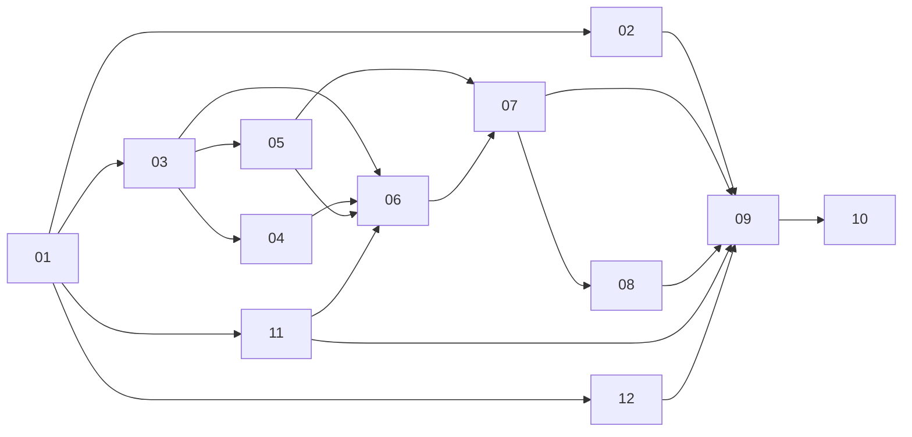

# 四模块深度化改造任务地图

> 文档角色：已交付阶段的历史设计/实施记录（2026-11-12复核）。12项已于2026-11-09交付。后续三天窗口、visit、消息设计及测试整理已完成；正文草图、旧类名及当时数量仅解释该检查点。 当前能力与进度见[项目状态](../../docs/project-status.md)。

Status: resolved

改造前源码基线：`9d20e301db5896c08896730a91a09f4a1b8cb058`（2026-11-08复核）。最终代码检查点：`a61b808`（2026-11-09）；01–12均已完成独立阶段验收和交付。完整规格见 [spec](spec.md)，当前设计见 [模块设计](../../docs/module-design.md)，最终结果见 [验证报告](../../docs/verification-report.md)。下方Comments按日期保留历史进度。

## 最终实现

| 领域 | 已落实的行为/设计 | Issue |
| --- | --- | --- |
| 预约暂占创建 | MANDATORY同库事务；设置→场次→就诊人，实际占号前日期复验，private步骤封装快照/占用 | 01、04 |
| 预约生命周期 | AppointmentLifecycle完整confirm/closePending/cancelConfirmed，内部锁/库存/序号/占用；Case仅本事务使用 | 03、06 |
| 支付回调与锁 | 纯PaymentNotificationPolicy、锁上下文和private execute；callback/T2/refund先payment父锁，资金/审计/Outbox原子提交 | 05 |
| 跨模块协调 | 完整interface加纯BookingLifecyclePolicy；保留归属/完整性/入口短路、退款原因和返回值 | 06、07 |
| 查询 | Projector/Assembler、SQL只读、列表一次serverTime；保留权限差异和DTO | 02、03 |
| 类型语言 | 状态、关闭/退款原因类型化，存储和HTTP/事件字符串不变 | 03 |
| 旧模拟路径 | 测试走正式attempt/签名通知/Outbox/Inbox；已删除旧端点与compat专用能力 | 08 |
| 迟到支付 | 待支付时同事务EXPIRED/释放/删占用/退款/Inbox；已关闭只确保退款，截止前收款可晚确认 | 11 |
| 消息可靠性 | 三次业务处理、两次一秒重试、耗尽DLQ、确认转发后ACK及保留eventId受控重放 | 12 |
| 最终门禁 | 架构违规反例、全部MySQL竞争及真实提交前/ACK前故障窗口，三层及Compose全通过 | 09 |

保持模块化单体、同库创建、Outbox/Inbox、条件更新、唯一约束和固定锁序；没有新增schema、事件版本、Redis缓存、微服务或Saga。只有旧dev/test同步模拟端点删除为已授权HTTP例外。旧支付改造map是历史资料，其16项不属于本轮12项；ADR0005覆盖旧半日/停诊写流程。

## Issue与依赖

Triage表示清晰度；Status独立表示claimed/resolved。只有所有Blocked by已resolved才能开始。实际执行顺序为 **01→11→12→02→03→04→05→06→07→08→09→10**，不是依赖图的唯一拓扑顺序。

| 顺序 | Issue | Type | Status | Blocked by |
| --- | --- | --- | --- | --- |
| 01 | [基线行为、状态决策表与风险证据](issues/01-baseline-state-matrix.md) | test | resolved | none |
| 11 | [迟到支付释放暂占](issues/11-late-payment-release.md) | fix | resolved | 01 |
| 12 | [消费有界重试与可靠转发](issues/12-bounded-consumer-retries.md) | fix | resolved | 01 |
| 02 | [查询流程投影与响应组装分离](issues/02-booking-query-projection.md) | refactor | resolved | 01 |
| 03 | [类型化状态、关闭原因与退款原因](issues/03-typed-lifecycle-language.md) | refactor | resolved | 01 |
| 04 | [预约暂占创建内部深度化](issues/04-appointment-hold-deepening.md) | refactor | resolved | 03 |
| 05 | [支付回调决策分离与支付锁序收敛](issues/05-payment-notification-policy.md) | refactor/fix | resolved | 03 |
| 06 | [预约与支付生命周期 interface 深度化](issues/06-lifecycle-interfaces.md) | refactor | resolved | 03, 04, 05, 11 |
| 07 | [跨模块生命周期决策与流程编排收口](issues/07-coordination-process-manager.md) | refactor | resolved | 05, 06 |
| 08 | [迁移支付测试并删除 dev/test 旧模拟路径](issues/08-remove-legacy-payment-simulation.md) | cleanup | resolved | 07 |
| 09 | [架构、并发与消息可靠性最终门禁](issues/09-architecture-and-reliability-gates.md) | test | resolved | 02, 07, 08, 11, 12 |
| 10 | [最终 interface、流程与验证文档交付](issues/10-documentation-delivery.md) | docs | resolved | 09 |

依赖图与每个issue的Blocked by一致（06含11，09含11/12）：

## 独立验收与提交

每阶段明确暂存文件、审阅cached diff、导出git暂存树独立快照并串行验收，记录实际结果后检查再提交；不推送。不能以工作区成功代替暂存快照成功，不能以测试数增长代替覆盖等价。

| Issue | 提交 | 独立快照验收（全部零失败/错误/跳过） |
| --- | --- | --- |
| 01 | c4f1dc0 | 常规154/MySQL24/可靠性10 + Compose |
| 11 | cb6931e | 常规159/MySQL25/可靠性10 + Compose |
| 12 | 937e717 | 常规166/MySQL25/可靠性13 + Compose |
| 02 | b6a12da | 常规168 + Compose（查询聚焦通过） |
| 03 | fd6e446 | 常规170/MySQL25/可靠性13 + Compose |
| 04 | 199c90a | 常规170/MySQL25 + Compose |
| 05 | ea89132 | 常规173/MySQL34/可靠性14 + Compose |
| 06 | 1255737 | 常规181/MySQL34/可靠性14 + Compose |
| 07 | 0a983b6 | 常规223/MySQL34/可靠性14 + Compose |
| 08 | b71c89f | 常规225/MySQL34/可靠性14 + Compose |
| 09 | a61b808 | 聚焦18、常规233/MySQL34/可靠性15 + Compose |
| 10 | 文档交付提交见Git日志 | 复用09同代码基线；文档/链接/字段/依赖检查及独立快照Compose通过 |

命令为 `./mvnw -o test`、`./mvnw -o -Pmysql-it verify`、`./mvnw -o -Preliability-it verify`，各profile独立执行且重复包含常规；Compose入口为 `python3 scripts/compose_acceptance.py`。详情见各issue Comments与 [baseline](baseline.md)，01→最终覆盖对照也在baseline。

## 数据、限制与回退

默认库2026-11-09只读复核V9、预约0、支付0，完整历史候选0；未迁移或自动修复。旧失败现场保留。最终保留查询与写入口权限差异、PROCESSING+CLOSED迟到回调契约，真实渠道未接入；若变更这些行为需另行确认，不属于本轮遗漏。

每issue可整体回退；已有下游依赖时按逆拓扑回退或做兼容调整，不保证任意抽掉上游仍可构建。无schema变更，代码回退不得删除已提交资金、Outbox/Inbox或退款，也不得直接调整库存。05父子锁变更必须整体评估，不能仅退一条路径形成不同锁序。

## Comments

- 2026-11-08：完成方案复核与本地issue拆分；全部issue未认领。明确ADR0005现行规则、支付反向锁风险、最终日期复验、入口短路/退款原因/查询权限，以及迟到事件残留暂占和普通消费重试限制；删除旧端点范围已获用户授权。
- 2026-11-08：本轮常规98、MySQL24、双容器可靠性9项全部通过，零跳过；这是当前实现基线，不是目标改造已验收。生产代码、测试源码、schema和历史ADR未改。

- 2026-11-08：文档结构校验通过：10项issue必填字段、连续编号、初始状态、依赖无环、地图收录、本目录Markdown本地链接和代码围栏均通过；Git状态仅本feature目录未跟踪，无生产/测试源码改动。

- 2026-11-08：开始 issue 11，迟到事件处理和聚焦 H2 测试已改动；该 issue 仍为 claimed，基线矩阵、独立事务回滚、MySQL/RabbitMQ 验收和历史只读盘点未完成。issue 12 和四模块结构改造尚未实施。

- 2026-11-08：继续推进 02、04、05、11、12，均处于 claimed；完成迟到支付和有界重试首轮实现、查询拆分、预约创建局部整理和支付父锁调整。三层门禁须基于最终代码重新执行，尚不标记 resolved。

- 2026-11-08：最新生产代码串行验证：常规 124 项、MySQL 24 项、双容器可靠性 10 项通过；随后补充不同 eventId 重复迟到支付的断言，并单独运行对应 H2 测试通过。历史业务数据库不可用，候选 SQL 尚未执行。完整 01–12 任务尚未完成。

- 2026-11-08：Compose 三服务健康，独立数据库和 vhost 的真实业务验收通过；阶段 1 暂存快照常规 98、MySQL 24、双容器 9 项通过。跨零点占号测试及完整决策矩阵仍未完成，01 保持 claimed。

- 2026-11-09：继续实施时 HEAD 为 ea5bbeb，交接所述在途生产改动已提交；初始仅 scripts/__pycache__/ 未跟踪。新增 [状态矩阵](state-matrix.md) 和边界断言；06、09依赖已按用户决定修正。独立快照门禁运行中，不提前标记 resolved。

- 2026-11-09：01独立快照常规154、MySQL24、双容器10及Compose真实链路全部通过，零跳过，01 resolved；提交号见 Git 日志及后续阶段记录。下一阶段11。

- 2026-11-09：11独立快照聚焦28、常规159、MySQL25、可靠性10及扩展Compose验收通过，全部零跳过，11 resolved。下一阶段12；生产修复已包含在ea5bbeb，不重复重写。

- 2026-11-09：12独立快照常规166、MySQL25、可靠性13及Compose通过，全部零跳过，12 resolved。11提交cb6931e；下一阶段02。

- 2026-11-09：02独立快照常规168、查询聚焦及Compose通过，零跳过，02 resolved。下一阶段03类型化语言。

- 2026-11-09：03类型化语言独立快照常规170、MySQL25、可靠性13及Compose通过，零跳过，03 resolved。下一阶段04。02提交b6a12da，12提交937e717。

- 2026-11-09：04独立快照聚焦22、常规170、MySQL25及Compose通过，零跳过，04 resolved。03提交fd6e446，下一阶段05。

- 2026-11-09：05独立快照常规173、MySQL34、可靠性14及Compose通过，全部零跳过，05 resolved。04提交199c90a；下一阶段06，全部依赖03/04/05/11已验收。

- 2026-11-09：06独立新快照聚焦72、常规181、MySQL34、可靠性14及Compose通过，全部零跳过，06 resolved。05提交ea89132；下一阶段07。

- 2026-11-09：07独立快照聚焦92、常规223、MySQL34、可靠性14及Compose通过，零跳过，07 resolved。06提交1255737；下一阶段08正式支付测试迁移及已授权Legacy删除。

- 2026-11-09：08独立快照常规225、MySQL34、可靠性14及Compose通过，零跳过，08 resolved。07提交0a983b6；下一阶段09，依赖02/07/08/11/12均已验收。

- 2026-11-09：09最终独立暂存快照聚焦18、常规233、MySQL34、可靠性15及Compose全部通过，零失败/错误/跳过；源码/构建/验收文件与快照逐字节一致，09 resolved。08提交b71c89f；下一阶段10文档交付。

- 2026-11-09：10独立暂存快照文档/字段/12项状态依赖及Compose全部通过，生产/测试代码与09保持一致；本轮01–12全部resolved，最终文档交付提交见Git日志，未推送。
