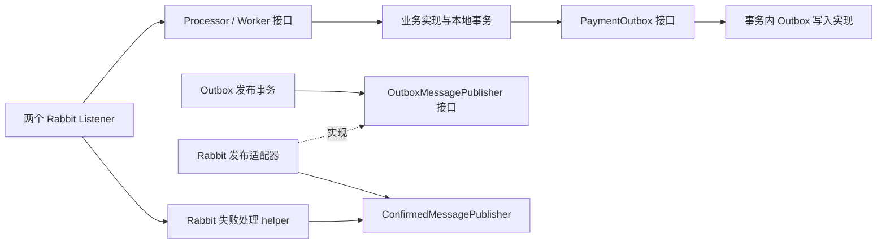

# Inbox、Outbox 与 RabbitMQ 代码设计改造方案

Type: refactor
Triage: ready-for-agent
Status: resolved

日期：2026-11-12（Asia/Shanghai）。九项改造及整体验收已完成；历史方案与确认记录保留。

源码读取基线：`cf027682bd516b57d0d2f0a830e3d592feee9eb3`。编写方案时工作区仅有原有未跟踪的 `scripts/__pycache__/`；不得清理或纳入本改造。开始实施前重新检查 HEAD 和工作区，基线漂移时先核对差异，不覆盖已有工作。

## 1. 目标与使用方式

本轮改善消息链路的可读性、接口契约、依赖方向和注释，保留预约与支付的现行业务语义，并对明确无效的消息输入增加严格校验。最终必须以本轮代码完成常规、真实 MySQL、MySQL + RabbitMQ 可靠性和隔离 curl 验收。

本方案不是通用消息平台设计，也不是新增业务清单。需要达到：

1. 支付、退款用例只表达业务事实，不再分别拼装 envelope 和 Outbox 初始状态。
2. RabbitMQ 实现不进入业务 application/domain；业务接口不暴露 AMQP 类型或持久化 Entity。
3. 两个监听器保留直观流程，共用可靠的失败转发行为。
4. 事件 v1 的字段、合法历史消息、队列和数据库保持兼容；非法输入收紧逐项标明。
5. 读接口注释就能了解事务、幂等、失败和重试责任；读实现能跟踪每次提交与 ACK。
6. 任务能逐项实施、独立验证、记录结果，全部门禁通过才声明整体完成。

阅读入口：

- [用户决策与设计树](decisions.md)：Q1～Q4 已确认，无待用户决定的范围项。
- [任务地图](map.md)：依赖、执行顺序、状态管理。
- [验收场景](scenarios.md)：S01～S32 与责任任务。
- [证据记录约定](verification/README.md)：实施时保存实际命令和结果。

## 2. 已确认范围

### 2.1 纳入

- 四类现有事件的类型化结构和生产端序列化契约。
- 事务内 Outbox 写入接口与实现，迁移三个现有事件生产位置。
- 两个消费 Codec 的一致校验规则，保留各自最小业务输入。
- 发布端不可变输入和明确异常契约；Rabbit 发布适配器迁包。
- Processor/Worker 内部返回值类型化。
- 两个监听器共用失败处理，保留明确的业务调用和成功 ACK。
- DLQ 重放的应用接口与 Rabbit 实现分离。
- 注释、架构约束、测试夹具迁移、真实故障窗口与最终验收。

### 2.2 本轮不实施

- Outbox 租约/处理中状态、短事务领取、事务外发布或 CDC/Debezium。
- 吞吐量压测、全局预约设置锁优化、Redis 库存、微服务拆分。
- 运维 HTTP、管理页面、自动告警平台、自动重置 FAILED。
- 退款结果监听器、短信/邮件/站内通知、真实支付渠道。
- 数据库迁移、历史业务数据修复、队列参数变更或事件 v2。
- 全部 Mapper 的 Repository 化、每个 Codec/工具类的接口化、泛型消费者框架。
- 注册登录、医生就诊或预约时间规则变更。

后续方向只登记到地图末尾，不作为本轮完成的隐藏前置条件。

## 3. 当前实现与改造动机

| 现有位置 | 已有保障 | 本轮要改善的点 |
| --- | --- | --- |
| `payment/application/PaymentNotificationServiceImpl` | 收款、审计与 Outbox 同事务 | 手工 Map/envelope、Entity 初始化和错位 Javadoc |
| `payment/application/DefaultPaymentRefundOperations` | 唯一退款单、退款申请与事件同事务 | 再次手工拼装事件与 Outbox |
| `payment/application/DefaultRefundWorker` | claim→事务外渠道→complete/fail；原 refundNo 幂等 | 结果事件的重复组装；String 结果 |
| `OutboxPublishTransaction` | SKIP LOCKED、确认后标发布、退避与 FAILED | 发布接口直接接收 Entity；失败类型宽泛 |
| `RabbitOutboxMessageSender` | 固定 v1 路由、持久化、保留 eventId/payload | Rabbit 实现放在 application |
| `DefaultPaymentSucceededProcessor` | Inbox 与预约/释放/退款申请同事务 | String 结果；入口契约需要进一步明示 |
| 两个 Listener | 事务成功后 ACK、确认转发后 ACK、耗尽 DLQ | 失败处理几乎重复 |
| 两个 Codec | 解码与业务处理已分开 | 退款 Codec 未校验类型；整数转换过宽 |
| `DeadLetterReplayService` | 白名单、原文重放、确认后 ACK | application 直接依赖 RabbitTemplate/Channel |
| `ModuleDependencyTest` | 限制跨业务 Mapper 和实现依赖 | 未禁止业务依赖 AMQP；Entity 检查主要覆盖返回值 |

重要事实：`common/ApiJsonConfig` 会把 Long 序列化为字符串，现行生产消息中的 Long ID 可能是 JSON 字符串。某些测试直接构造 JSON 数字 ID。两者都属于需要保留的合法输入，不能换 DTO 后悄悄统一成只接受一种。

## 4. 不变量与兼容约束

以下约束在每一步实施及最终验收中都有效。

### 4.1 数据与业务

- 保留单 Spring Boot、单 Maven、同一 MySQL 的模块化单体。
- 保留 Flyway V1～V10；不新增/重写迁移，不调整业务表和约束。
- 保留请求幂等、有效预约占用、库存守恒、固定锁序、预约凭证与费用快照。
- 保留三天预约入口、锁后准入、持久化支付截止，以及 `paidAt` 严格早于截止的资格规则。
- 保留支付已到账、预约尚在确认的最终一致过程及用户查询语义。
- 保留 REST 路径、DTO、HTTP 状态和权限；内部 Java 返回类型允许迁移。
- 完成就诊不释放号源库存；消息改造不写 visit 业务状态。

### 4.2 事务和消息

| 链路 | 必须保留 |
| --- | --- |
| 收款通知 | 支付结果、通知审计、成功 Outbox、必要迟到退款一起提交或回滚 |
| 退款申请 | 退款单、REFUND_PENDING、RefundRequested 与调用方事务协同提交 |
| 支付成功消费 | Inbox、预约确认或关闭释放/退款申请同事务；失败不能留下已处理凭证 |
| 退款执行 | 短事务 claim → 事务外渠道 → 短事务 complete/fail；不套预约确认的整段 Inbox 模板 |
| Outbox 发布 | 保留持锁批量发布；获 confirm 且无 return 才标 PUBLISHED；不声称消费已完成 |
| 消费确认 | 业务事务成功返回后 ACK；ACK 失败不回滚已提交业务 |
| 重试转发 | 确认转发成功后 ACK 原消息；转发失败 NACK/requeue 原消息 |
| 重放 | 原正文、eventId 不变；不删除 Inbox、创建新事件 ID 或调整库存绕过去重 |

正常确认仍以已提交事件为事实，不强制新增支付表查询。已确认预约收到新 eventId 的同一事实仍应短路；不要因更严格解码而改变这项业务决策。

### 4.3 拓扑与配置

交换机保持：`appoint.domain-events`、`appoint.domain-events.retry`、`appoint.domain-events.dlx`。

| 事件 | routing key | 业务队列 |
| --- | --- | --- |
| PaymentSucceeded | `payment.succeeded.v1` | `appointment.payment-succeeded.v1` |
| RefundRequested | `payment.refund.requested.v1` | `payment.refund-worker.v1` |
| RefundSucceeded | `payment.refund.succeeded.v1` | `notification.refund-result.v1` |
| RefundFailed | `payment.refund.failed.v1` | `notification.refund-result.v1` |

业务/重试/DLQ 队列名称、绑定、持久化和 TTL/DLX 行为不变。退款结果队列仍无监听器，不宣称有通知效果。

保留 `appoint.messaging.enabled` 和 `appoint.outbox.*` 的现有语义、默认值与扫描配置；`enabled` 只限制对应定时/监听入口，不擅自改变显式调用。消费者仍首次加两次约一秒 TTL 重试；确认等待仍为现有五秒。集中常量即可，不为单次策略新增配置体系。

## 5. 目标代码组织和依赖方向

以下生产路径都相对于 `src/main/java/com/qsx/appoint/`；类型名是实施目标，若需微调必须同步本方案、任务和引用。

```text
payment/
  contract/event/                  # 支付拥有的 v1 wire contract，纯 record
    PaymentEventEnvelope.java
    PaymentSucceededPayload.java
    RefundRequestedPayload.java
    RefundSucceededPayload.java
    RefundFailedPayload.java
  application/
    PaymentOutbox.java             # 新增：四类业务事实的事务内记录接口
    DefaultPaymentOutbox.java      # 新增：序列化并写 Outbox，MANDATORY
    OutboxMessagePublisher.java    # 现有接口收紧
    OutboxMessage.java             # 新增：发布需要的不可变快照
    OutboxPublicationException.java
    OutboxPublisher.java           # 保留定时入口及显式用例
    OutboxPublishTransaction.java  # 保留现有发布事务方案
    DeadLetterReplayService.java   # 由具体类改为应用接口
    ReplayTarget.java
    ReplayResult.java
    RefundWorker.java
    RefundExecutionResult.java
    DefaultRefundWorker.java
  messaging/
    RabbitOutboxMessageSender.java # 从 application 移入
    RabbitDeadLetterReplayService.java
    RefundRequestedEventCodec.java
    RefundRequestedListener.java
  config/
    RabbitEventTopology.java       # 保留配置位置、名称和声明
coordination/
  application/
    PaymentSucceededProcessor.java
    PaymentSucceededResult.java
    DefaultPaymentSucceededProcessor.java
    PaymentSucceededEvent.java     # 继续作为本用例输入，不要求等同 wire payload
  messaging/
    PaymentSucceededEventCodec.java
    PaymentSucceededListener.java
  persistence/
    CoordinationInboxEventMapper.java # 保留本模块内直接使用
common/messaging/
  ConfirmedMessagePublisher.java   # Rabbit 专用传输 helper，保留即可
  RabbitConsumerFailureHandler.java
  RabbitRetryRoute.java
  MessageJsonFields.java           # 仅复用严格的字段读取，不承载支付业务
```

依赖方向：



约束：

- `payment/coordination` 的 `application/domain` 不依赖 `org.springframework.amqp..` 或 `com.rabbitmq..`。
- `payment.contract.event` 不依赖 Spring、Jackson、Mapper、Entity 或消费者实现；支付不得反向引用 coordination 的内部事件输入。
- 业务接口参数和返回类型不得暴露预约/支付 Entity，包括泛型、数组和嵌套 record 成员。
- 保留 Spring 事务与依赖注入，不把本轮扩大为去除一切框架依赖。
- 同模块 Mapper 仍允许作为实现依赖；不增加只转发一次 Mapper 调用的 Repository。
- `MessageJsonFields`、Codec、Rabbit helper 是实现细节，可保持具体类；不要求每类一个 interface。

## 6. 事件 v1 的生产与消费契约

### 6.1 公共 envelope

`PaymentEventEnvelope<T>` 固定字段：

| 字段 | 生产语义 | 消费要求 |
| --- | --- | --- |
| eventId | 新业务事件生成一次 UUID | 消费入口校验 UUID；重发与重放不改 |
| eventType | 四个既有事件名之一 | 各消费者要求其确切类型 |
| eventVersion | 整数 1 | 不支持的版本、非整数类型拒绝 |
| aggregateId | paymentOrderId | 整数数字或整数字符串；与 payload 的 paymentOrderId 一致 |
| occurredAt | 对应事实发生的本系统时间 | 合法 LocalDateTime 文本；沿用当前上海业务时间语义 |
| payload | 对应事件载荷 | 必须为对象；按各事件要求读取 |

公共结构不增加 JSON 多态类型信息、类名或新字段。生产继续使用 Spring 管理的 ObjectMapper 和现有 Long 序列化规则。保留现行字段名、数值金额、null 字段及无偏移时间格式；不更改全局 HTTP ObjectMapper。

### 6.2 四类 payload

| 类型 | 保留字段 |
| --- | --- |
| PaymentSucceededPayload | paymentOrderId、appointmentOrderId、paymentAttemptId、providerTransactionNo、amount、currency、channel、paidAt |
| RefundRequestedPayload | refundId、refundNo、paymentOrderId、paymentAttemptId、providerTransactionNo、amount、currency、channel、reason |
| RefundSucceededPayload | refundId、refundNo、paymentOrderId、providerRefundNo、failureMessage |
| RefundFailedPayload | refundId、refundNo、paymentOrderId、providerRefundNo、failureMessage |

退款结果两个 record 可有相同字段，但语义不同；成功时 failureMessage 为 null，失败时 providerRefundNo 为 null，按现行生产行为保留。字段 null/非空条件从既有生产事实和真实夹具验证，不把“结果队列无监听器”扩展为新增结果消费。

事件 contract record 表达消息，不用 Entity，也不放入消费者的 application 包。消费者可以只映射实际需要的字段，但必须先验证自己承诺的 envelope。

### 6.3 严格读取规则与批准的行为修正

本轮明确收紧的内容：

1. 错误事件类型、不支持的版本、空/非对象报文和缺失关键字段，返回现行 `VALIDATION_ERROR`，Listener 按永久无效处理。
2. ID 必须是正 Long 范围的整数。接受 JSON 整数数字及只由十进制数字组成、可解析的文本；拒绝浮点节点（包括 `1.0`）、小数、科学计数数字节点、布尔、空白、越界、零、负数。文本前导零可保留兼容；不把空白或正号隐式清洗成合法值。
3. eventVersion 必须是 JSON 整数节点且等于 1，不接受文本 `"1"`、小数或静默默认值。
4. PaymentSucceeded 的金额保留 JSON 数值读取，其业务入口仍要求正金额和 CNY；不新增无关精度或渠道限制。RefundRequested 消费校验 envelope、refundId/refundNo、paymentOrderId 及聚合关联，不把 Worker 未使用的 amount/currency/channel 等字段新增为消费必填；完整生产 payload 的全部原字段另由生产契约测试保护。
5. RefundRequested Codec 新增确切 eventType、envelope 字段及 aggregateId/paymentOrderId 一致性校验；完整现行生产消息必须通过。
6. PaymentSucceeded 保持既有 aggregateId/paymentOrderId 一致校验，补足严格整数规则；不强制它读取/使用此前业务入口未使用的渠道流水字段。
7. 允许额外未知字段，以兼容不影响当前消费者的扩展；不使用全局拒绝未知字段设置。
8. 不新增 Rabbit messageId、headers.eventType、headers.eventVersion 必须存在或相等的门槛。现有消费者依据正文，合法正文无这些属性也可处理。

另有两项技术错误处理修正需在任务记录中单列：发布器数据库标记异常必须逃出事务并回滚整批（04），失败处理对非法重试头显式拒绝且避免计数溢出（05）。它们不改变合法业务路径，但不能把它们描述为只有类名/包名移动。

严格字段读取放在小型 `MessageJsonFields` 具体类；它只负责 JSON 形态/整数/文本/时间，不访问数据库、不制定退款规则。Codec 负责 envelope 与载荷关联，Processor/Worker 保留 UUID、必填及业务条件复验，保护直接 Java 调用。直接业务入口违反已声明 ID/版本约束同样返回 VALIDATION_ERROR。

兼容测试应包含两类相互独立的样本：基线保存的历史 JSON，以及生产端真实写入 Outbox 的 JSON；不能只用同一个新 record 生成期望值。

## 7. 接口与实现契约

### 7.1 PaymentOutbox：事务内保存事件

建议接口表面保持四个明确用例，避免公开 `Object` 或任意事件名：

```java
public interface PaymentOutbox {
    String recordPaymentSucceeded(PaymentSucceededPayload payload, LocalDateTime occurredAt);
    String recordRefundRequested(RefundRequestedPayload payload, LocalDateTime occurredAt);
    String recordRefundSucceeded(RefundSucceededPayload payload, LocalDateTime occurredAt);
    String recordRefundFailed(RefundFailedPayload payload, LocalDateTime occurredAt);
}
```

`DefaultPaymentOutbox` 对外方法采用 `Propagation.MANDATORY`：

- 事务必须已经存在；通过 Spring 代理调用，禁止 REQUIRES_NEW、异步或方法内自调用绕过契约。
- 生成一次 eventId，组装 envelope 和 PaymentOutboxEvent，写 PENDING、失败次数 0、nextAttemptAt。
- aggregateType 固定 `PaymentOrder`，aggregateId 从 payload.paymentOrderId 取得，避免双参数不一致。
- occurredAt、paidAt、业务数据来自调用方已锁事实，不在写入器重读支付或重算截止。
- 序列化/数据库失败向外传播，让业务写入一起回滚；返回仅表示本事务已登记，未提交也未发送。
- 重复事件防护仍由业务入口的支付状态、通知审计、退款唯一约束负责；不能误称每次调用 append 自带全业务幂等。

实现内部可用一个 private 泛型辅助方法集中赋值，不暴露通用事件总线。迁移三处生产者，删除被替代的手工 Map、序列化方法及未使用依赖；测试故障注入须仍命中真实事务路径。

### 7.2 OutboxMessagePublisher：发布不可变快照

```java
public record OutboxMessage(String eventId, String eventType, int eventVersion, String payload) {}

public interface OutboxMessagePublisher {
    void publish(OutboxMessage message) throws OutboxPublicationException;
}
```

`OutboxPublicationException` 为明确的 RuntimeException，保留 cause。它表示“未获可靠发布确认”，不保证 Broker 一定未收到。可在消息中区分未知类型、return、NACK、超时和连接失败，但不为本轮建立复杂异常继承树。

发布事务从 Entity 创建 record；Rabbit Adapter 只按现有类型选路，保留原 payload 字节语义、eventId、持久化和元数据，不重新序列化、不重新生成事件。对数据库内历史 Outbox 不要求先转换成新 contract record 再发送。

`ConfirmedMessagePublisher` 继续作为 Rabbit 专用 helper。公共契约要明确 confirm 与 return 检查、超时不确定性和中断恢复；只在应用发布适配器处转成 OutboxPublicationException，避免把数据库状态写入失败误报成纯 Broker 失败。

`OutboxPublishTransaction` 保留事务、锁和退避方案。仅围绕 `publisher.publish` 捕获 `OutboxPublicationException`，记录发布失败后继续下一条。`markPublished`、影响行数检查和 `recordFailure` 自身的数据库异常必须向外传播，使整批事务回滚；不能将数据库异常累计为 Broker 发布失败或返回成功计数。批内前面已写的发布标记也随事务回滚，Broker 已收消息允许按原 ID 重投，由 Inbox/业务幂等保护。此处不改变 FAILED 的人工恢复边界。

### 7.3 Processor/Worker 返回值

- `PaymentSucceededResult`：DUPLICATE、ALREADY_CONFIRMED、CONFIRMED、REFUND_REQUIRED。
- `RefundExecutionResult`：SUCCEEDED、ALREADY_SUCCEEDED。

将两个接口、实现、测试装饰器和断言一起迁移；不改外部 JSON、数据库状态或消息字段。Listener 仍以成功返回判断可以 ACK，不按结果重新执行业务。REFUND_REQUIRED 表示退款申请已持久化；退款 Worker 两个成功结果表示本地已记录退款成功。

### 7.4 Inbox

保留 `CoordinationInboxEventMapper.insertIgnore`，唯一键仍为 `(consumer_name,event_id)`，消费者名仍是 `appointment-payment-succeeded-v1`。它必须加入 Processor 的事务，不提前独立提交。

本轮不新建 Inbox Repository/通用执行器，不把不同退款执行模型统一进去；在接口/实现注释中明确这些差异。保留重复 eventId 与新 eventId 重复业务事实的两层保护。

### 7.5 RabbitConsumerFailureHandler

两个 Listener 仍明确写出：解码→调用业务接口→成功后 ACK。仅将重复的失败处理委托给具体 helper。

建议表面：`handle(original, channel, tag, eventId, failure, retryRoute)`。`RabbitRetryRoute` 是两个固定消费路径的描述，包含路由、计数头和日志名称；不接受任意不受控目标，也不从用户请求构造。

helper 承担：

- 明确无效契约立即 Reject(false)；其余失败按现行有界策略重试。
- 克隆原消息，保留正文、messageId、eventId 与其他必要属性；只更新对应计数和 TTL。
- 首次失败计数为 1，第二次为 2，第三次拒绝进入 DLQ；实际物理投递可能更多。
- 转发确认成功才 ACK 原消息；转发失败 NACK(true)，不同时再 ACK。
- ACK/NACK 的 IOException 向外传播，禁止包成业务失败再重复转发。

不要为 helper 增加数据库事务、业务状态判断、反射注册表、抽象 Listener 基类或通用消息处理引擎。`Channel` 等 AMQP 类型出现在 Rabbit 专用 helper 中是合理的。

进入失败处理后才检查重试头，正常/幂等成功仍直接 ACK，不为它新增头校验前置门槛。失败处理规则：缺失视为首次；接受非负、int 范围内的整数型数值头（兼容 Rabbit 解码得到的 Integer/Long），先比较已耗尽次数再加一，防止 Integer.MAX_VALUE 溢出。已大于或等于两次失败的计数本次直接耗尽；负数、非整数或超 int 范围属于无效属性，直接拒绝并记录原因，不能 ClassCastException 后无限热重投。正常计数名称和语义保持，增加边界测试。

### 7.6 DeadLetterReplayService

保留名称作为应用接口，实际实现迁为 `messaging/RabbitDeadLetterReplayService`。应用接口不暴露 RabbitTemplate、Channel、Message 或物理队列参数：

```java
public interface DeadLetterReplayService {
    ReplayResult replayOne(ReplayTarget target);
}
```

`ReplayTarget` 只有 PAYMENT_SUCCEEDED、REFUND_REQUESTED、REFUND_RESULT，Rabbit 实现映射到既有三个 DLQ；`ReplayResult` 区分 EMPTY 与 REPLAYED，并携带可空 eventId。保留“正文缺 eventId 不补造”的行为，避免把空队列与已转发但无 ID 混为同一个 null。

重放契约：一次最多一条；源队列受控；原正文不变；清除两个现行重试计数头和消息 expiration；按既有映射转发并等确认；之后 ACK 源投递，失败尝试 NACK/requeue 并传播异常。重放不读取/修改 Outbox、Inbox、退款或库存。

不在这一步新增完整业务消息校验或强制 Rabbit 元数据；消费者承担已批准的严格校验。退款结果按既有 eventType 分流，不支持的结果类型仍失败并保留原消息。无监听器的退款结果重放不等于通知成功。

## 8. 注释与可读性要求

每个任务同时维护注释，不把注释全部推迟到最后。

| 位置 | 必须解释 |
| --- | --- |
| 类 | 职责、不承担的邻近职责、主要协作者、事务所在位置 |
| 接口方法 | 输入前提、正常返回含义、幂等范围、失败和重试责任、事务要求 |
| 关键顺序 | 为什么同事务、为什么先 confirm 再 ACK、为什么重试保留 ID |
| 配置/SQL | 状态含义、计数区别、锁前提、影响行数要求 |

使用中文业务语言，保留必要技术名。不要给显然的赋值堆注释；不要在语句内部放含 `@param/@return` 的 Javadoc。修复 PaymentNotificationServiceImpl 中错放的审计说明；在正确的方法处补充说明。

明确区分：eventId 与请求幂等键、发布失败次数与消费重试次数、PUBLISHED 与消费成功、退款申请与退款完成、至少一次与业务幂等效果。不要写“消息绝不丢”“恰好投递一次”“所有故障自动恢复”。

最终给出一条生产路径和两条故障路径的代码阅读入口：支付成功正常确认、发布成功后未标记、业务提交后 ACK 丢失。

## 9. 实施顺序与文件迁移注意事项

详细清单见 [map](map.md) 和各 issue，建议串行执行 01→02→03→04→05→06→07→08→09。每步先认领、再改造、完成验证后 resolved；不能把未来测试写成已通过。

关键迁移事项：

- 保持或同步 Spring bean 名称、构造器、组件扫描和测试 `@Qualifier("defaultPaymentSucceededProcessor")`。
- `PaymentConfirmationReliabilityIT.BeforeCommitFailureProcessor` 的返回类型随接口迁移，保留装饰真实事务代理的故障注入语义。
- 测试中直接 `new DeadLetterReplayService(...)` 的位置迁为 Rabbit 实现或注入应用接口；不要保留两个相互转发的旧新服务掩盖迁移遗漏。
- 退款可靠性测试有只含 refundId/refundNo 的最小夹具，严格 Codec 后需补成现行合法 envelope/payload；仍必须实际进入渠道并验证失败重试，不能提前被 Codec 拒绝却宣称测试通过。
- Outbox 发布测试中有不完整业务 JSON，用于验证传输而非解码。发布器继续原文转发，不要求这些传输专用夹具拥有全部业务字段。
- 不删除旧测试规避编译错误；改断言时保留它原本保护的业务/故障窗口。
- 迁包/删除组件后做干净构建，避免 target/classes 中旧 class 被重复扫描；不能通过放宽架构规则隐藏残留产物。结果 enum 迁移还要核对 AppointmentLifecycleIntegrationTest、PaymentParentLockMySqlIT 的内部 String 断言，支付通知审计等外部字符串不变。
- 不引入新的 Maven 模块或第三方消息依赖；新的 contract 包受已有架构规则约束。

## 10. 验证策略与证据

### 10.1 基线

01 记录实际 HEAD、工作区、相关源码清单、契约样本和既有测试覆盖。历史报告记载常规 263、MySQL 37、curl 92；可靠性 15 属于此前检查点。这些数字仅供定位，不是本轮运行结果，不作为必须凑齐的数量目标。

### 10.2 阶段验证

- 每任务执行自身相关纯规则/Codec/Listener/事务测试；涉及行锁或真实传输时增加相应集成测试。
- 使用基线夹具和真实生产 Outbox 验证两种 ID 表示、字段名、null、时间、类型和版本。
- 异常链路断言业务未产生不当写入，并检查实际重试次数/间隔、原文与 ID、ACK/NACK 顺序。
- 架构规则既要检查生产代码通过，也要以故意违规 fixture 验证能拒绝错误依赖。
- 用例名称可以调整，场景覆盖不能减少；见 S01～S32。

### 10.3 最终门禁

在项目根目录，所有 Maven 命令串行运行：

```bash
./mvnw clean test
./mvnw -Pmysql-it verify
./mvnw -Preliability-it verify
docker compose --env-file compose.env up -d --wait
python3 scripts/compose_acceptance.py --http-client curl --http-report .scratch/messaging-design-refactor/verification/curl-report.json
git diff --check
```

离线依赖齐备时可使用 `-o`，实际命令如实记录；Compose 脚本本身使用 Maven 离线模式。先检查 Docker、镜像和本地依赖，不以跳过容器测试替代验收。

profile 重复执行的常规测试不累计为新增数量。验证消息专项与真实 HTTP 的正常链路是不同证据，不能互相代替。最终业务源码或测试再次变化时重跑受影响门禁，记录被测代码检查点。

环境问题可先完成独立可执行工作，但任务保持未验收，不宣布整体成功。不得删除数据卷、泄露 .env/compose.env 凭据或清理旧失败现场。成功隔离资源由验收脚本清理；失败按脚本保留标识与脱敏日志；记录最后服务状态，不擅自停止用户原有服务。

## 11. 风险与回退

| 风险 | 处理 |
| --- | --- |
| record 序列化改变字段/null/ID | 基线样本与真实生产消息双向核对，不改全局 mapper |
| Appender 分离破坏事务 | MANDATORY、外部注入 Bean、真实回滚故障测试 |
| listener 提取后误 ACK | 两条链路执行同一失败矩阵，ACK 失败单独传播 |
| Codec 加严让测试提前 DLQ | 检查真实 Worker 调用次数、失败落库及一秒间隔 |
| 迁包影响 Bean/测试装饰 | 保留接口注入，核对扫描、Qualifier、构造器与测试替身 |
| 公开类型改动被旧架构规则拦截 | 在对应任务同时迁移规则与调用方，不通过放宽整体规则解决 |
| Broker 慢导致持锁发布变慢 | 记录现有限制，本轮不引入租约；不宣称性能提升 |
| 旧应用不接受新的严格输入边界 | 合法 v1 不变；记录非法输入收紧，不反向修复历史业务 |

无 schema 和拓扑变化。每任务代码可整体回退；已有下游时逆依赖回退或同步兼容调整，不保证单独抽掉任意上游仍可编译。代码回退不删除支付、退款、Outbox、Inbox 或历史业务记录；消息仍可能重投，继续依赖原 ID 与幂等。

用户已于 2026-11-12 授权按本方案实施，并要求每一步验收成功后单独 Git 提交；不推送。按任务范围核对文件和测试结果，避免纳入配置、target、缓存和历史失败资源。

## 12. 最终完成条件

- [x] 01～09 全部 resolved，地图、场景证据与 Comments 一致。
- [x] 三个事件生产位置完成迁移，无重复的 envelope/Outbox 初始化。
- [x] 应用消息接口无 Entity/AMQP 泄漏；Rabbit 具体实现迁移完成。
- [x] 两个 Codec 合法兼容、非法收紧有明确测试；业务返回类型化。
- [x] 两个 Listener 共用可靠失败处理，Inbox 与退款各自事务语义保持。
- [x] DLQ 重放应用接口不暴露物理队列；原文/ID/确认顺序保持。
- [x] 注释覆盖事务、失败和重试责任，关键路径可按文档直接阅读。
- [x] S01～S32 有实际覆盖证据，最终四类业务验收成功且无意外跳过。
- [x] 正式设计和 runbook 与实现一致，历史记录保留，未实现边界如实说明。

## Comments

- 2026-11-12：完成源码、领域文档和测试读取；Q1～Q4 已由用户确认。仅创建方案及待执行任务，未修改生产/测试源码，未执行本轮 Maven 或业务验收。

- 2026-11-12：01～09全部完成，最终常规323、MySQL38、可靠性16、curl92成功，详细证据见verification。每步独立验收并提交，未推送。
