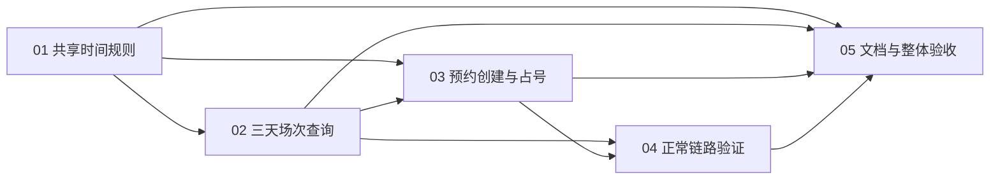

# 三天预约窗口改造任务地图

Type: feature
Triage: ready-for-agent
Status: resolved

日期：2026-11-11。

源码检查点：`5d49ff95d294ddfa0aef259f64d2907d93c50889`。这是任务拆解时的读取基线，不是本功能的实现提交；实际被测代码摘要和执行结果见[验收证据](verification/scenario-evidence.md)。

## 目标与入口

- [总体需求与代码设计](spec.md)：业务规则、包结构、REST 字段、Service、事务及 SQL 的唯一设计基线。
- [场景与覆盖清单](scenarios.md)：R01～R11 规则索引、S01～S18 场景、主责任任务与验证方式。
- `issues/`：五项已完成的实现任务，每项保留具体文件、前置条件、验收清单和实际检查记录。

新预约入口支持今天、明天、后天的四场；开始前 15 分钟停止接新订单；每单支付截止为创建时间加 15 分钟与场次开始时间的较早者。查询、创建与支付分别承担展示、准入和原订单资格判断。

本目录保留设计基线、已完成的五项任务及验收证据。三天时间规则已实现，不扩展退款或技术故障场景。

## 任务与依赖

| 顺序 | 任务 | Type | Status | Blocked by |
| --- | --- | --- | --- | --- |
| 01 | [共享预约时间规则](issues/01-booking-time-rules.md) | feature | resolved | none |
| 02 | [三天场次查询与响应](issues/02-session-query.md) | feature | resolved | 01 |
| 03 | [预约创建、时间采样与占号 SQL](issues/03-appointment-creation.md) | feature | resolved | 01, 02 |
| 04 | [正常支付、查询和就诊链路](issues/04-payment-flow.md) | test | resolved | 02, 03 |
| 05 | [现行文档同步与整体验收](issues/05-docs-and-acceptance.md) | docs | resolved | 01, 02, 03, 04 |

推荐执行顺序为 **01 → 02 → 03 → 04 → 05**，各阶段 Maven 命令串行运行。02 和 03 共用查询与创建测试前提，按此顺序减少在途契约混杂。

## 状态约定

沿用项目已有任务格式：

- 初始 `Status: ready-for-agent` 表示任务定义清楚、尚未认领；`Triage` 保留准备标签。
- 只有全部 `Blocked by` 指向的任务均为 `resolved`，任务才可开始。
- 开始实际实现时将任务及本表状态改为 `claimed`。
- 实现和本任务验收均完成后改为 `resolved`，在任务 `Comments` 记录实际命令、结果和未验证内容，并同步本表。
- 文档写好不等于实现完成，不提前勾选验收清单，不用历史测试数量代替本轮结果。

01～05 均已实现和验收，场景证据见 verification/scenario-evidence.md。

## 接口与实现约束

本轮新增生产类型为 `catalog.model.BookingTimeRules` 和 `catalog.model.ScheduleAvailability`。保持模块化单体，复用现有 Controller、Service 和同库创建事务；不新增数据库迁移、时间配置管理接口或日期专用下单接口。

场次 GET 仍返回 `Result<List<ScheduleResponse>>`，从 28 项变为 12 项，追加 `bookingClosesAt`、`availability`、`serverTime`；创建、支付、详情、列表和签到沿用现有路径。接口准确字段以 [spec 第五节](spec.md#5-rest-契约)为准。

既有订单不受新的创建窗口重新裁定，支付模块不检查新下单截止。保存的订单创建时间和支付截止不得随着查询或日期滚动重算。

## 每阶段验收与最终交付

| 阶段 | 可检查交付 |
| --- | --- |
| 01 | 三天日期、四场截止及支付期限集中计算；纯规则测试验证日期与时间计算 |
| 02 | 十二项有序场次、统一查询时间和展示状态；查询不写库 |
| 03 | 当天合法场次可创建；Java 与 SQL 同一准入时刻；预约/支付时间一致；创建用例夹具符合新窗口 |
| 04 | 下单截止后原单可付，跨日可付，确认、全部预约查询、签到与医生接诊继续工作；验收入口使用合法日期 |
| 05 | 正式文档与代码一致；新增 ADR 明确替代旧窗口；执行并记录本轮常规、MySQL 与真实 HTTP 验收 |

阶段问题在实际负责的任务处理；05 负责整体验收和文档收口，不把未完成的实现转成文档上的完成声明。场景覆盖详见 [scenarios](scenarios.md)。

## 交付记录

| 项目 | 当前结果 |
| --- | --- |
| 方案与任务文档 | 已创建，静态检查结果见 Comments |
| 生产代码和测试改造 | 五项任务已完成 |
| Maven 与业务 HTTP 验收 | 最终常规 263、MySQL 37、真实 curl 92 次请求通过 |
| 实现任务完成数 | 5 / 5 |

## Comments

- 2026-11-11：根据已认可的业务方案和当前源码完成五项任务定义、依赖图与场景索引；所有实现任务尚未认领，现行 API、生产代码、测试和数据库均未改造。原有 `scripts/__pycache__/` 未处理。
- 2026-11-11：文档静态检查通过：八份 Markdown、五项任务、十八个场景、十一个规则编号、三十五个本地链接/锚点、两段 JSON 示例；任务依赖无环，Mermaid 边与任务依赖一致，地图/任务状态一致，围栏和空白检查通过。该结果只证明文档结构一致，不代表实现或业务验收通过。

- 2026-11-11：01 纯规则 9 项通过，resolved；02 claimed，开始目录查询改造。

- 2026-11-11：02 聚焦 32 项通过，resolved；03 claimed。Compose 三依赖已健康启动，保留原卷。

- 2026-11-11：03 常规 258 项、MySQL 预约集成 13 项通过，resolved；04 claimed。

- 2026-11-11：04 聚焦 30 项和真实 HTTP/MySQL 2 项通过，resolved；05 claimed，开始完整验收和文档收口。

- 2026-11-11：05 完成。最终常规 263 项/MySQL 37 项通过；完整隔离 Compose/curl 92 次请求符合预期，运行 e34a8b021efb。首次报告目录缺失已修复并从头重跑；旧失败资源保留。全部任务 resolved，场景与代码摘要见[验收证据](verification/scenario-evidence.md)；验收完成时尚未提交，最终本地交付提交以 Git 历史为准，不推送。

- 2026-11-11：最终静态检查通过：29 份 Markdown、205 个本地链接/锚点、16 段 JSON 示例、18 个 HTTP JSON 请求体；五项任务状态/依赖一致、十八个场景证据齐全，29 个实现/测试文件摘要匹配，92 次 curl 记录状态及脱敏检查通过。Compose 三依赖最终健康，未改动旧数据卷。
