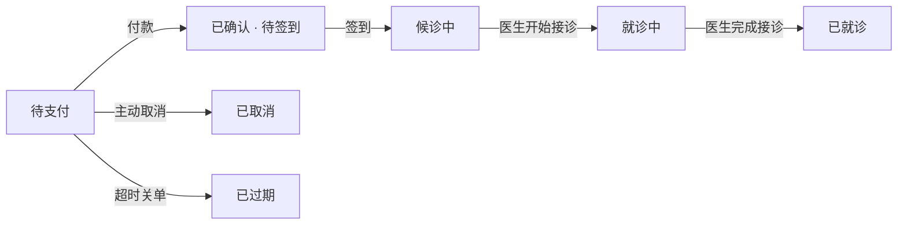

# 医院预约业务流程

## 从预约到接诊

1. 用户登录并添加启用的[就诊人](patient-examples.md)。新用户可在注册时通过 [Mailpit](http://127.0.0.1:8025) 查收验证码。
2. 选择医院、科室、医生和场次后提交预约。系统保存就诊人、目录、场次和挂号费快照，创建一张预约单和一张支付单，暂占一个名额。结果未确认时，可在原页面再次点击「提交预约」，已成功的提交会返回原回执。同场次同一就诊人或同一种证件及号码只能有一张有效预约，证件约束跨账号生效。[下单幂等设计](booking-idempotency.md)
3. 用户点击「模拟支付」后，预约同步确认，系统发放场次内的就诊序号。序号按确认顺序分配。用户可在支付前取消，逾期未支付由后台关单，两种操作都会释放暂占。
4. 用户在窗口内到院签到，进入候诊。负责该预约的医生在工作台开始并完成接诊，双方均可查询就诊进度。

已确认的预约不能自助取消。签到和接诊只更新就诊进度，预约保持已确认、支付保持已收款。即使签到窗口结束，已签到者仍可由医生接诊。未签到的已确认预约继续显示待签到。

## 关键时间

业务时间使用 `Asia/Shanghai`。

| 操作 | 规则 |
| --- | --- |
| 新下单 | 只接受今天、明天和后天的场次，须严格早于开诊前 15 分钟 |
| 支付已有订单 | 截止时间为下单时间加支付时限（默认 15 分钟）与场次开始时间中的较早者，创建时保存，截止当秒仍可支付 |
| 首次签到 | 开诊前 30 分钟起开放，到场次结束时关闭，以预约保存的起止时间为准 |

例如 `10:30` 开诊的场次从 `10:15:00` 起拒绝新订单。在 `10:14:00` 创建的订单仍可在 `10:29:00` 付款，从 `10:29:01` 起会被拒绝。后台随后关闭超时订单并释放名额。若关单前通过取消接口处理该单，也按过期关闭。

## 场次设置与库存

| 场次类型 | 时间 | 下单截止 |
| --- | --- | --- |
| `MORNING_FIRST` | 08:00–10:00 | 07:45 |
| `MORNING_SECOND` | 10:30–12:00 | 10:15 |
| `AFTERNOON_FIRST` | 14:00–16:00 | 13:45 |
| `AFTERNOON_SECOND` | 16:30–18:00 | 16:15 |

每位医生展示三天共 12 个场次，首次下单才生成实际场次。初始设置为每场 20 人、挂号费 10 元。管理员修改设置后，之后首次生成的场次采用新设置，已有场次沿用自己的容量和费用。

总容量等于可用、暂占和已确认名额之和。付款将名额从暂占转为已确认，取消或过期则将暂占还给可用库存。

完整验证签到和接诊可使用 [test 业务调时](environments.md#test-业务调时)。接口字段见 [REST API](api.md)，写入规则见[模块设计](module-design.md)。

## 站内通知

预约确认、到院签到、开始接诊和完成接诊四个节点会向下单账号生成站内通知：

| 节点 | 通知标题 | 发生时间 |
| --- | --- | --- |
| 支付确认预约 | 预约成功 | 本次支付确认时间 |
| 首次到院签到 | 签到成功 | 本次签到时间 |
| 医生开始接诊 | 开始接诊 | 本次开始接诊时间 |
| 医生完成接诊 | 完成接诊 | 本次完成接诊时间 |

通知只发给预约单上的下单账号，不发给就诊人或医生。待支付、主动取消和支付超时的预约不产生通知。同一预约的同一节点最多一条通知；重复支付、重复签到或重复接诊操作不会产生第二条。

通知内容使用预约单创建时的就诊人、医院、科室、医生快照，以及确认时分配的就诊序号；事件生成后再修改就诊人或医疗目录，已有通知保持不变。消息中心按业务发生时间倒序显示，投递是异步的，刚完成操作后稍等或手动刷新即可看到。

通知从模块上线后的新业务动作开始生成，历史预约不补发。消息中心只显示当前登录账号自己的通知，不区分普通用户、医生或管理员角色。
