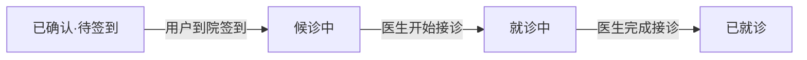

# 医院预约业务流程

业务时间按`Asia/Shanghai`解释。账号用户维护就诊人并为其预约；医生账号由管理员绑定医生档案后取得接诊权限。字段与错误码见[API](api.md)，事务实现见[模块设计](module-design.md)。

## 场次、设置与库存

医院、科室和医生每天正常工作。管理员维护目录和统一设置，初始为每场20人、挂号费10.00 CNY；更新只影响之后首次生成的场次，已有场次与订单保留快照。

| 场次类型 | 时间 | 下单截止 |
| --- | --- | --- |
| MORNING_FIRST | 08:00–10:00 | 07:45 |
| MORNING_SECOND | 10:30–12:00 | 10:15 |
| AFTERNOON_FIRST | 14:00–16:00 | 13:45 |
| AFTERNOON_SECOND | 16:30–18:00 | 16:15 |

用户看到今天、明天、后天共十二项，已截止场次仍展示。未生成场次按当前设置计算，查询不写库；首次下单才生成实际场次。可预约状态按已开诊、已截止、已约满、可预约的顺序判断。

每场独立满足：`总量 = 可用量 + 暂占量 + 已确认量`。就诊序号在确认时按场次单调分配，取消后不复用，也不表示精确看诊时间。

## 注册到预约成功

1. 用户注册、登录，在“就诊人”新增资料。停用就诊人不能新下单，修改或停用不改写已有预约凭证。
2. 选择医院、科室、医生、可预约场次和就诊人，核对费用后提交。
3. 系统暂占一个名额，原子创建预约单及支付单，预约进入`PENDING_PAYMENT`。
4. 用户发起MockPay支付并模拟渠道成功；收到受理响应后继续等待正式处理结果。
5. 资金确认后通过消息链路确认预约，暂占转为已确认名额，分配就诊序号；页面显示“预约已确认 · 待签到”。

下单必须严格早于场次开始前15分钟，并处于服务端今天至后天。资格以锁后实际占号前的准入时间为准，前端展示不能替代写入口复验。

每次提交带UUID幂等键：同账号同键同内容返回原预约标识，同键不同内容拒绝；取消或过期后重约使用新键。同场次相同就诊人或规范化证件只能有一张有效预约，证件限制跨账号生效。

预约保存就诊人、医院、科室、医生和费用快照。之后修改资料不会改写历史凭证。我的预约包含全部历史状态，按就诊日期、开始时间、预约ID同向排序，默认DESC，可选ASC。

## 支付、截止与异步确认

支付截止为`min(创建时间 + 配置时限, 场次开始时间)`，当前时限15分钟。预约与支付单保存同一截止，重试和查询不重算；恰好到截止即不能再支付。

停止新下单不影响旧单在自己的截止前支付。例如10:14创建10:30场次的订单，10:15后仍可按本单截止付款。跨零点已创建订单同样按持久化截止处理，三天入口滚动不删除旧预约。

支付尝试处理中为`PAYING`，失败后仍有资格可重试，同一支付单不能有多个活跃尝试。MockPay成功操作返回202只表示通知已受理；用户可能先看到确认中，再看到已确认。

本系统处理可信通知时的`paidAt`决定是否及时收款，渠道上报的时间不决定截止资格。截止前已确认收款，即使消息稍后消费仍可确认待支付预约；截止时刻或之后才确认的收款进入迟到退款。

## 取消、过期与退款

| 情况 | 结果 |
| --- | --- |
| 待付款时取消 | 关闭订单，释放暂占并删除有效占用；到期时按EXPIRED关闭 |
| 待付款超时 | 扫描关闭为EXPIRED，释放暂占；扫描延迟不延长支付资格 |
| 已确认且距开诊严格超过24小时取消 | 取消、释放已确认名额、申请原路全额退款 |
| 已确认且距开诊不超过24小时取消 | 拒绝，恰好24小时也不允许 |
| 收款后预约尚未确认时取消 | 写入口仍可按当前事实关闭并申请退款 |
| 已取消、已过期或超时后收到成功收款 | 保留关闭事实，确保原路全额退款 |

异步退款受理返回202，需继续查询到退款完成。重复取消、通知或消息不会重复释放库存、分配号码或创建退款。取消后的号码不复用。

展示标记保留兼容差异：到期待支付仍可能`canCancel=true`，写入口按时间置为过期；已付待确认的`canCancel=false`，取消写入口仍可受理。资金以支付记录为准，不能仅看页面按钮推断。

## 到院签到与接诊

首次签到窗口为**[预约开始前30分钟,预约结束)**，按预约日期及起止时间快照计算。08:00–10:00场次在07:30开放，10:00整截止；开诊后窗口内仍可签到。查询显示资格，写入口重新判断并记录服务端时间。

已确认预约没有就诊记录时计算为`NOT_CHECKED_IN`；签到创建`WAITING`，开始接诊转`IN_PROGRESS`，完成转`COMPLETED`。重复动作返回状态冲突，保留首次时间。

医生工作台按日期显示四场人数，分项之和等于已确认人数。名单按就诊序号升序，待签到和已就诊都可查看；候诊行可以开始，就诊中行可以完成。未签到者不阻塞已签到者，不强制队首或跨行忙碌限制。医生只操作本人预约，允许已签到记录在场次结束后或跨日接诊。

签到接诊期间预约仍为`CONFIRMED`、支付仍为`PAID`；不释放名额、重排号码、改写快照或触发退款。超时未签到仍为待签到，不自动取消、退款或标记爽约。完成接诊后用户刷新原预约即可查看相同状态和时间。

## 体验路线与边界

优先完整走一遍注册到接诊完成，再分别体验支付失败重试、未付款取消、提前取消退款、超时和迟到收款、统一设置快照。dev/demo使用真实时间，可先体验明天场次的预约成功；test可用[调时入口](environments.md#test业务调时)验证当天签到和超时。各分支使用独立订单，回拨时间不会撤销已完成事实。

项目不包含病历处方、自动叫号、爽约、实时推送或真实支付渠道。旧半日场次和历史关闭终态继续可读，不用于新预约。
