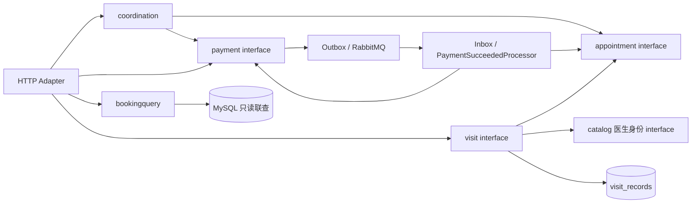

# 核心模块代码设计与事务契约

签到窗口于2026-11-13按新规则更新，源码基于`4bfc1d5`的未提交工作区；决策见[ADR0008](adr/0008-visit-checkin-window.md)。

本文对应预约支付核心模块及新增 visit 就诊模块的当前实现。业务结果见 [业务流程](business-flow.md)，HTTP 字段见 [API](api.md)，历史实测覆盖与后续文档核对见 [验证报告](verification-report.md)。系统仍是一个 Spring Boot 应用、同一 MySQL，原四模块改造保留既有数据库和事件版本；数据库最新为 V10；三天窗口、消息设计和测试整理均已交付，后两轮未新增迁移，事件契约仍为 v1；Redis 仅作为本地依赖运行。

已新增 `visit` 就诊模块，详细接口与实现见 [到院签到与门诊接诊设计](visit/design.md)，前后行为见 [改动范围](visit/change-scope.md)。预约支付既有事务及消息恢复契约继续适用。

## 模块职责与入口

| 模块 | 拥有的知识 | 调用者使用的 interface |
| --- | --- | --- |
| appointment | 预约暂占、有效占用、库存、凭证快照、就诊序号 | `AppointmentHoldService`、`AppointmentCreationRequestService`、`AppointmentLifecycle` |
| payment | 支付单、尝试、通知验签与审计、退款、Outbox、渠道调用 | `PaymentOrderCreationService`、`PaymentAttemptService`、`PaymentNotificationIngress`、`PaymentLifecycle`、`PaymentRefundOperations`、`RefundWorker`、`PaymentOutbox`、`DeadLetterReplayService` |
| coordination | 同库创建、取消、过期、确认与对账的跨模块规则 | `BookingCoordinator`、`BookingLifecycleCoordinator`、`PaymentSucceededProcessor` |
| bookingquery | 预约/支付/退款/就诊组合，以及医生四场概览、名单和详情 | `AppointmentService`、`DoctorVisitQueryService` |
| visit | 窗口内签到、开始与完成接诊，共享一份就诊记录 | `VisitService`、纯规则 `VisitRules` |

appointment 和 payment 写模块互不引用；coordination 使用稳定 application interface、业务事实和事件，不接触写模块 Mapper、Entity 或 implementation。HTTP Adapter 可以调用 coordination。bookingquery 可读取两侧数据及稳定类型，写模块不能反向依赖它。

## 主方法与内部规则

- [AppointmentHoldServiceImpl](../src/main/java/com/qsx/appoint/appointment/application/AppointmentHoldServiceImpl.java) 保留创建步骤，用 private 方法封装按需场次、占号、有效占用和快照构造。在锁后实际占号前采样准入时间，复验三天日期及场次开始前十五分钟截止，同时计算预约/支付创建时间和截止快照。
- [PaymentNotificationServiceImpl](../src/main/java/com/qsx/appoint/payment/application/PaymentNotificationServiceImpl.java) 表达幂等短路、锁定上下文、锁下复验、纯 Policy 决策、private execute。资金结果、通知审计、成功 Outbox 和必要迟到退款保持同一事务；不另开 Executor 事务。
- [BookingLifecyclePolicy](../src/main/java/com/qsx/appoint/coordination/application/BookingLifecyclePolicy.java) 只判断预约与支付组合事实，返回动作及关闭/退款原因，不读 Clock、数据库或渠道。Coordinator 保留归属校验、完整性、入口短路和事务顺序；事件 Processor 保留格式校验及 Inbox。
- [BookingWorkflowProjector](../src/main/java/com/qsx/appoint/bookingquery/application/BookingWorkflowProjector.java) 负责组合状态，`AppointmentResponseAssembler` 负责支付关联完整性、可操作标记、脱敏及 DTO，查询主方法负责账号归属及一次列表时间采样。可操作标记不替代写入口权限校验；SQL、DTO 以及既有权限差异保持兼容。

纯 Policy 与单一内部 Assembler 不额外增加 interface。类型化的预约/支付状态和关闭/退款原因在 Java 层使用，持久化 Entity、Mapper、HTTP 和事件继续使用既有字符串；未知存储状态转为 `INTERNAL_ERROR`。

## 三天场次与时间规则

[BookingTimeRules](../src/main/java/com/qsx/appoint/catalog/model/BookingTimeRules.java) 是无 Spring/数据库/Clock 依赖的共享纯规则，供 catalog 查询与 appointment 暂占调用。它集中表达上海时间 D～D+2、开始前十五分钟下单截止及支付 min 计算；payment 不反向引用该规则。

`CatalogServiceImpl` 一次采样 serverTime，返回十二项；`ScheduleAvailability` 按 STARTED、CUTOFF_REACHED、FULL、AVAILABLE 的优先级派生，bookable 只在 AVAILABLE 为 true。新增 bookingClosesAt、availability、serverTime 均不持久化，GET 不创建场次。

创建事务先登记 requestRegisteredAt；`CreateAppointmentHoldCommand` 不携带外层时间。暂占实现锁定设置、场次、就诊人并读取资料后，采样 acceptedAt，使用同一采样执行 Java 资格与 `holdOneBookableSession` 条件占号。SQL 比较三天范围及场次日期/开始时间是否严格晚于 acceptedAt 加十五分钟，不用数据库当前时区判定资格。

acceptedAt 同时保存为预约/支付创建时间；支付截止取创建时间加配置时限与场次开始的较早者，经 `AppointmentHold`、`CreatePaymentOrderCommand` 原样复制。创建响应 serverTime 在结果组装时采样。支付尝试与详情只使用已存截止，不能再套用新下单截止；我的预约不按三天入口过滤历史。决策见 [ADR 0007](adr/0007-three-day-booking-and-session-cutoffs.md)。

## 深生命周期 interface

[AppointmentLifecycle](../src/main/java/com/qsx/appoint/appointment/application/AppointmentLifecycle.java) 暴露 `find`、`lock`、`confirm`、`closePending`、`cancelConfirmed`。调用者只选择完整动作：

- `lock` 在内部按场次→预约加锁，返回 `AppointmentLifecycleCase`。
- `confirm` 在内部完成 held→confirmed、读取并递增下一就诊序号及确认预约，返回确认结果。
- `closePending` 释放暂占、按关闭原因置终态并删除有效占用。
- `cancelConfirmed` 释放已确认名额、取消并删除有效占用；序号不复用。

[PaymentLifecycle](../src/main/java/com/qsx/appoint/payment/application/PaymentLifecycle.java) 暴露 `find`、`lockByAppointment`、`closeUnpaid`，返回 `PaymentLifecycleCase`。关闭只推进支付单，不关闭 PROCESSING 支付尝试、不调用渠道；后续 PROCESSING+CLOSED 成功通知仍按迟到支付退款。

两种 Case 都是稳定事实，不暴露 Entity、库存或下一序号。`find` 是普通查询，其结果不能授权写入。锁方法和生命周期写方法使用 `Propagation.MANDATORY`：外层必须已有 Spring 事务，否则拒绝。写入只接受本事务 `lock` 返回的原对象；复制、伪造、上次事务缓存或传入 `REQUIRES_NEW` 均被拒绝。事务同步器维护身份上下文，随事务挂起/恢复并在完成后清理；一次写操作后须重新 lock 才能再写。

## 事务与锁序

| 用例 | 事务范围与顺序 |
| --- | --- |
| 创建 | `BookingCreationTransaction`：幂等登记→预约暂占→支付单→幂等回执，同库提交；两个创建写 interface 都要求 MANDATORY |
| 创建内部锁 | 统一设置→场次生成/锁定→就诊人锁定→锁后准入时间、日期/截止复验及条件占号；失败回滚场次、库存、订单与幂等键 |
| 取消/过期/对账 | 外层 Coordinator 事务；先 `AppointmentLifecycle.lock`（场次→预约），再支付父记录，必要时退款子记录；Policy 不获取锁 |
| 成功事件 | Processor 事务：校验→Inbox登记→预约内部加锁→Policy→完整确认或关闭退款；不为普通确认重读支付单 |
| 尝试 T1/T2 | T1 payment→attempt，事务外调用渠道，T2 先只读定位再 payment→attempt，锁后复验关联 |
| 通知 | 先幂等只读短路；只读定位 attempt，再 payment→attempt→notification 复验；资金/审计/Outbox原子提交 |
| 退款请求/worker | 请求 payment→refund→成功attempt；worker claim、complete、fail 都先 payment 再子记录，渠道退款在两段本地事务之间 |
| 医生绑定 | `DoctorAccountService` 同库事务，医生→用户加锁，角色授予和首次条件绑定一起提交 |
| 签到/开始/完成 | `VisitService` 各自事务，读取稳定预约事实，只写 visit_records；唯一键和原状态条件 UPDATE 防止重复 |
| 查询 | 用户与医生组合查询无写事务，不获取行锁；Mapper 只声明静态只读 SELECT |

只读定位用于找到父记录，不代替锁下复验。不能持有 payment 子记录再反向等待父记录，也不能在支付路径反向锁预约。条件 UPDATE 行数、唯一约束和 InnoDB 行锁仍是最终防线；应用 Policy 不代替数据库约束。

创建的事务外入口 `DefaultBookingCoordinator` 负责规范化幂等键/摘要并调用事务 Bean。事务先插入账号内幂等登记，同键唯一冲突退出并回滚后，外层才查询已提交记录、比较摘要并返回重放回执。登记、暂占、支付单及完成回执一起提交，不能在捕获重复键的创建事务里继续返回成功。

## 事件、重复与恢复

事件 envelope 保留 `eventId`、`eventType`、`eventVersion=1`、`aggregateId`、`occurredAt` 和 `payload`。`PaymentSucceeded` 的 aggregateId 是 paymentOrderId；payload 保留 paymentOrderId、appointmentOrderId、paymentAttemptId、providerTransactionNo、amount、currency、channel、paidAt。paidAt 是本系统确认渠道收款的服务端时间，不使用渠道 occurredAt 决定截止资格。

| 事件 | routing key | 业务队列 |
| --- | --- | --- |
| PaymentSucceeded v1 | `payment.succeeded.v1` | `appointment.payment-succeeded.v1` |
| RefundRequested v1 | `payment.refund.requested.v1` | `payment.refund-worker.v1` |
| RefundSucceeded / RefundFailed v1 | `payment.refund.succeeded.v1` / `payment.refund.failed.v1` | `notification.refund-result.v1` |

退款结果队列及其重试/DLQ 拓扑已声明，但当前没有 `RefundSucceeded` / `RefundFailed` 监听器，不代表短信或邮件通知已经实现；退款状态在 worker 的本地事务中保存，详情查询直接读取数据库。

### Outbox 发布

支付通知或退款事务将资金结果与 Outbox 一起写入 MySQL，不在这些业务事务中等待 Broker。`OutboxPublisher` 定时调用独立事务 Bean `OutboxPublishTransaction`，使用 `FOR UPDATE SKIP LOCKED` 领取到期 PENDING，持有本批事件锁发布到 `appoint.domain-events`；多发布器可跳过彼此锁住的记录。

`RabbitOutboxMessageSender` 沿用已保存的 payload 和 eventId，设置持久化消息并选择固定路由；`ConfirmedMessagePublisher` 等待 Publisher Confirm 且检查 mandatory return。仅确认成功且无退回才记录 PUBLISHED。Broker 接收、数据库标记与最终消费不能原子提交；确认不确定或确认后提交前崩溃均可能重复投递。

| Outbox 状态 | 含义与处理 |
| --- | --- |
| PENDING | 未获可靠发布确认，达到 nextAttemptAt 后可被领取 |
| PUBLISHED | 发布获 Broker 确认且没有路由退回，不代表消费完成 |
| FAILED | 发布失败次数耗尽，保留原事件待人工处理，不代表支付或退款业务失败 |

当前 `application.yml` 配置：扫描间隔 5 秒、每批 50 条、累计发布失败上限 8 次、确认等待 5 秒，退避从 1 秒指数增加、上限 5 分钟。`publishAttempts` 是发布失败计数，与消费者重试头和退款单的执行计数不同；实际再次执行还受扫描周期影响。发布器仅领取 PENDING，不自动重置 FAILED。

### 消费事务与幂等

- 支付成功：`PaymentSucceededListener` 解码后调用带事务代理的 Processor。Inbox、预约确认的库存/序号，或关闭释放和退款申请在同一事务提交；提交前失败一起回滚，提交后 ACK 丢失的重投由 Inbox 和预约状态去重。
- 退款请求：`RefundRequestedListener` 调用 worker；worker 用 `TransactionTemplate` 短事务 claim，事务外调用渠道，再以短事务 complete 或 fail。已提交的领取/失败事实不会随整个监听器调用失败而撤销；不使用预约确认 Inbox，依靠唯一退款单、本地成功状态及渠道 refundNo 幂等。渠道成功、本地保存失败时仍可能再次请求渠道，必须沿用原 refundNo。

两种监听器均在业务用例成功返回后手动 ACK；Publisher Confirm 是发布确认，消费者 ACK 是处理确认，二者不能互相替代。事件和退款按至少一次投递设计。

### 消费重试、DLQ 与对账

支付成功处理首次加两次 TTL 重试合计三次，两次间隔一秒；永久无效消息直接 DLQ，耗尽也进入 DLQ。转发到 `appoint.domain-events.retry` 确认成功后才 ACK 原消息；失败 NACK/requeue。退款执行保留三次处理及渠道 refundNo 幂等。Broker 故障或确认不确定可带来额外投递，三次计数不构成绝对物理投递上限。

`DeadLetterReplayService.replayOne(ReplayTarget)` 仅允许三个逻辑目标映射的已登记 DLQ，原正文及 eventId 保持不变，重置对应重试计数和 TTL，确认目标发布成功后 ACK 原 DLQ 消息；失败 NACK/requeue 保留原消息，没有开放 REST 重放接口。该服务处理 RabbitMQ DLQ，不处理数据库中的 Outbox FAILED；退款结果事件即使重放，目前也没有监听器处理。

对账当前每 5 分钟扫描一次，按 5 分钟滞留阈值、每类最多 100 个候选处理已付待确认和已关闭已付缺退款：前者按 paidAt 恢复确认或关闭退款，后者确保退款。长期 PENDING/FAILED Outbox、PENDING/FAILED 退款、CREATED/PROCESSING 尝试及可关联记录中的账号/金额/币种不一致仅计数并输出人工项；不会自动重置 Outbox、重放 DLQ、查询渠道或修复历史库存。关联统计不覆盖所有缺失关联，不能当作完整数据库一致性证明。不得删除 Inbox、生成新 eventId 绕过幂等或直接修改库存来补偿；运维处理见 [切换与恢复手册](runbooks/payment-module-cutover.md#6-失败处理与前向恢复)。

## 消息代码契约与阅读入口（2026-11-12）

设计取舍：保留模块化单体、同模块Mapper和Spring事务，以明确业务接口隔离传输依赖；不全面Repository化或逐类增加interface。合法历史v1保持兼容，非法输入类型与关联校验允许收紧。Outbox租约、运维HTTP、通知和真实渠道另属未实现范围。

本轮保持业务、数据库 V1～V10 和 Rabbit 拓扑不变，整理的是代码职责、输入校验、接口和注释。没有新增消息框架、租约状态、真实渠道或通知消费者。

| 职责 | 接口/实现 | 契约 |
| --- | --- | --- |
| 记录事件 | [PaymentOutbox](../src/main/java/com/qsx/appoint/payment/application/PaymentOutbox.java) / DefaultPaymentOutbox | 四个明确业务事实；MANDATORY 加入调用方事务，序列化/写入失败一起回滚 |
| wire 结构 | [PaymentEventEnvelope](../src/main/java/com/qsx/appoint/payment/contract/event/PaymentEventEnvelope.java) 与四个 payload record | 原六字段 envelope、版本1、原 payload；支付拥有契约，不依赖消费者实现 |
| 发布 | [OutboxMessagePublisher](../src/main/java/com/qsx/appoint/payment/application/OutboxMessagePublisher.java) / messaging.RabbitOutboxMessageSender | 接收不可变 OutboxMessage，无 Entity/AMQP 入参；确认失败可能已送达 |
| 支付消费 | PaymentSucceededProcessor / DefaultPaymentSucceededProcessor | 返回 PaymentSucceededResult；Inbox 与确认/补偿同事务 |
| 退款消费 | RefundWorker / DefaultRefundWorker | 返回 RefundExecutionResult；仍分段事务与渠道 refundNo 幂等 |
| 失败传输 | [RabbitConsumerFailureHandler](../src/main/java/com/qsx/appoint/common/messaging/RabbitConsumerFailureHandler.java) | 两个监听器共享失败分类/重试/确认，正常成功 ACK 留在监听器 |
| 重放 | [DeadLetterReplayService](../src/main/java/com/qsx/appoint/payment/application/DeadLetterReplayService.java) / messaging.RabbitDeadLetterReplayService | ReplayTarget 控制三个逻辑目标；ReplayResult 区分 EMPTY 与 REPLAYED，可空 eventId |

### 事件写入与发布

PaymentNotificationServiceImpl、DefaultPaymentRefundOperations、DefaultRefundWorker 不再分别拼 Map/envelope 或初始化 Outbox Entity，分别调用 PaymentOutbox 的成功收款、退款申请、退款成功/失败方法。事件 ID 创建一次，occurredAt/paidAt 沿用用例给定事实，支付聚合ID从载荷取得。

写入器正常返回只表示在当前事务中登记；事务可能尚未提交，消息尚未发送。业务入口原有状态/通知/退款唯一约束继续负责幂等，不能对该写入器重复调用后期待自动合并所有业务事件。

发布仍持有本批数据库行锁等待 Broker，不引入租约。只在 publisher 调用周围捕获 OutboxPublicationException；数据库 markPublished、影响行数检查或失败进度写入异常传播并回滚整批，不被累计为 Broker 失败。已经发送的消息可能重发，原正文和事件 ID 不变。

### 输入校验与兼容

生产 ObjectMapper 继续将 Long 写成文本。两个 Codec 接受正 Long 范围的整数数字与十进制文本，允许额外未知字段和缺 Rabbit 元数据；拒绝浮点/小数/越界/非正 ID、错误事件类型、非整数或非1版本、错误结构/时间。文本 ID 不隐式清洗空白/正号，前导零文本仍可解析。

退款 Codec 新增 envelope 类型、版本、时间、支付聚合关联校验，但只向 Worker 提供必要退款标识，不将金额/渠道等未使用字段新增为消费必填。PaymentSucceeded 保留金额/CNY及支付聚合校验。Processor/Worker 仍做必要入口复验，不把 Codec 当唯一保护。

重试头只在进入失败处理后检查。Integer/Long 非负 int 范围计数兼容；先比较耗尽再递增，防止溢出；非法类型/负数/越界拒绝，避免热重投。正常成功不增加头校验门槛。公开 HTTP/资金审计状态字符串不变，enum 仅替换 Java 内部结果。

### 三条代码阅读路径

1. 正常确认：PaymentNotificationServiceImpl → PaymentOutbox → OutboxPublishTransaction → messaging.RabbitOutboxMessageSender → PaymentSucceededListener → PaymentSucceededProcessor → AppointmentLifecycle；最后由 Listener ACK。
2. Broker 已收到、DB标记失败：发布事务回滚 → 原 Outbox 保持待发 → 再发同 eventId → Inbox 或已确认业务事实短路；确认名额与序号不重复推进。
3. 业务已提交、ACK丢失：Listener 抛确认异常 → Broker重投 → Processor 的 Inbox 去重 → 再ACK，不撤销已提交业务。

退款渠道成功、本地落库失败时，重试仍用原 refundNo；退款成功状态与原渠道幂等结果保证收敛，不能用预约 Inbox 声称外部退款恰好一次。

### 依赖与测试

application/domain 不依赖 Spring AMQP 或 Rabbit Client；contract 包不依赖 Spring/Jackson/持久化；common messaging 不反向引用业务模块。应用接口检查入参、返回值及 record/泛型中的 Entity 泄漏，架构测试有违规负例。保留本模块 Inbox Mapper 和 Spring 事务，不全面 Repository 化。

方案与阶段记录见 [任务地图](../.scratch/archive/messaging-design/summary.md)，最终执行结果见 [验证报告](verification-report.md)。固定旧 JSON 样本与新生产 Outbox 的契约测试分别验证兼容，真实 MySQL/Rabbit 继续验证事务和故障窗口。

## 兼容边界与验证

旧 dev/test 同步模拟成功端点及 compat 支付尝试已删除，开发支付走真实 attempt→签名通知→Outbox→Inbox。正式 HTTP、schema V1–V10 与事件 v1 保持兼容。查询仍保留“到期待支付可取消”和“待确认已付 canCancel=false、写入口可取消退款”的历史差异。

[架构测试](../src/test/java/com/qsx/appoint/architecture/ModuleDependencyTest.java) 用生产依赖及故意违规 fixture 固定上述约束；静态 SQL 检查不是任意动态 SQL 的完整证明。接口行为用快速事务测试，锁/约束用 MySQL，传输及故障窗口用 RabbitMQ，实际 HTTP 链路用隔离 Compose；当前覆盖对照见[逐方法审计](../.scratch/archive/delivery-quality/evidence/test-suite-refactor/method-audit.md)和[消息场景映射](testing/scenario-coverage.md)；[旧baseline](../.scratch/archive/payment-lifecycle/evidence/booking-module-deepening/baseline.md)只记录2026-11-09改造前后的历史。

## 就诊写入与医生身份

`VisitService` 的三个动作各有本地事务，只读取 `AppointmentLifecycle.find()` 的稳定事实，通过 `DoctorAccountService` 解析医生，只写本模块 visit_records；不反向访问 bookingquery 或外部 Mapper。`AppointmentLifecycleCase` 包含 doctorId 和预约结束时间快照 endTime，其 find/lock 写授权含义不变。签到的一对一唯一键和两个带原状态条件的 UPDATE 防止并发重复操作与覆盖首次时间。

`VisitRules` 是查询和写入共享的纯规则：已确认、未签到且处于[预约开始前30分钟,预约结束)才可签到；窗口由预约快照推导。WAITING 可开始，IN_PROGRESS 可完成。签到写入口按不存在/归属→状态→开放→截止校验，资格与记录使用同一次秒精度采样；列表使用统一 serverTime。医生动作不另限日期或时间；时间推进不自动结束就诊。医生名单不按状态重排，也不强制队首或跨行互斥。

医生账号绑定按医生→用户加锁，在同库事务中增加角色并条件绑定。账号唯一约束和首次绑定条件防止换绑；角色授予不覆盖原角色。查询 Mapper 只读，医生查询按登录身份限定范围，详情用快照和既有脱敏方式。

真实 HTTP 就诊验收由 scripts/compose_acceptance.py 使用测试源码中的 VisitAcceptanceApplication 替换业务 Clock；生产启动类和配置不接受该受控时间，JWT 继续使用系统时间。验收先完成支付、退款及 Outbox 发布，再重启到就诊日，避免 MockPay 内存事实丢失影响资金操作。
