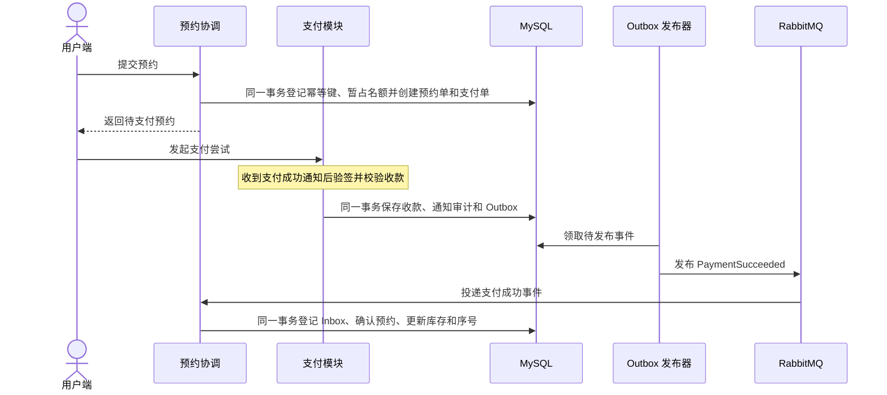

# 模块设计与维护

项目采用模块化单体，后端由一个 Spring Boot 应用运行，前端独立构建。MySQL 保存业务记录，Redis 用于目录缓存和注册验证，RabbitMQ 投递支付与退款事件。业务规则见[业务流程](business-flow.md)，接口契约见 [REST API](api.md)，设计原因见 [ADR](adr/)。

[模块职责](#模块职责与依赖) · [核心链路](#预约与支付链路) · [事务与锁序](#事务与锁序) · [维护与恢复](#维护与恢复)

## 模块职责与依赖

| 模块 | 职责 |
| --- | --- |
| `auth`、`user`、`patient` | 注册、登录、角色和本人就诊人 |
| `catalog` | 医疗目录、统一预约设置、场次查询和医生账号绑定 |
| `appointment` | 暂占、有效占用、库存、预约凭证和就诊序号 |
| `payment` | 支付单、支付尝试、通知验签与审计、退款、Outbox |
| `coordination` | 协调创建、取消、过期、支付确认和对账 |
| `bookingquery` | 只读组合用户预约与医生工作台所需的数据 |
| `visit` | 到院签到、开始接诊和完成接诊 |
| `localenv` | 本地环境校验、互斥、初始化、[就绪探测](api.md#本地环境识别)和 test 调时 |

`appointment` 和 `payment` 的写入通过各自的应用接口完成，由 `coordination` 编排。跨模块联查集中在只读查询路径。HTTP 控制器通过应用层访问业务数据。

## 预约与支付链路

上图为按时支付的确认路径。[创建协调器](../src/main/java/com/qsx/appoint/coordination/application/DefaultBookingCoordinator.java)在重复键冲突回滚后查询已提交的登记。只有同键、同内容且已完成的登记才返回[重放回执](api.md#创建预约)。[支付确认处理器](../src/main/java/com/qsx/appoint/coordination/application/DefaultPaymentSucceededProcessor.java)依据已提交的收款事实推进预约，迟到收款按[退款规则](business-flow.md#取消过期与退款)处理。

## 数据关系

| 数据 | 关系与写入点 |
| --- | --- |
| 账号与医生 | `users` 通过 `user_roles` 获得角色，`patients` 属于账号。医生账号绑定具有唯一约束，角色授予与首次绑定同事务 |
| 预约场次 | `schedules` 按医生、日期和场次类型唯一，保存容量、费用快照、库存和下一就诊序号 |
| 预约单 | `appointment_orders` 保存凭证、支付截止和序号。有效占用与账号内幂等登记分别记录在 `appointment_active_claims` 与 `appointment_create_requests` |
| 支付单 | `payment_orders` 与预约一对一，关联支付尝试、通知审计、退款和 Outbox |
| 就诊记录 | `visit_records` 在签到时创建，与预约一对一，保存进度与动作时间 |

初始化和旧库兼容范围见 [Flyway 基线](environments.md#flyway初始化基线)。环境账号见[预置目录和账号](environments.md#预置目录和账号)。

## 事务与锁序

| 用例 | 事务与锁序 |
| --- | --- |
| 创建预约 | 幂等登记 → 首次才读取统一设置并建场 → 条件更新锁定场次并暂占 → 锁就诊人、复验准入 → 预约、支付及回执 |
| 取消、过期、对账 | 场次 → 预约 → 支付父记录 → 必要的退款子记录 |
| 支付成功事件 | 校验 → Inbox 登记 → 场次和预约 → 确认或发起退款。正常确认直接使用事件中的收款事实 |
| 支付尝试 | 建尝试和保存结果分别使用短事务，均先锁支付单再锁尝试。中间在事务外调用渠道 |
| 支付通知 | 只读定位后，依次锁定支付单、尝试和通知记录。资金、审计与 Outbox 同事务提交 |
| 退款执行 | 先锁支付单再锁退款单。领取、完成和失败落库各用短事务，渠道调用在事务外 |
| 医生绑定 | 医生 → 用户，与授予角色同事务 |
| 签到与接诊 | 读取预约事实，只写就诊记录。唯一约束与状态条件更新保护首次动作时间 |

[暂占服务](../src/main/java/com/qsx/appoint/appointment/application/AppointmentHoldServiceImpl.java)按医生、日期和场次定位库存。已有场次由条件更新获得该行排他锁并暂占名额。首次下单通过 `INSERT … SELECT` 读取统一设置并复制快照，用场次唯一键处理重复建场。MySQL 默认隔离级别下，建场语句以共享锁读取设置，不同场次可并行读取。锁定场次和就诊人后重新采样准入时间，超过截止或窗口时回滚暂占。生命周期锁定与写入要求已有事务。写操作使用本事务锁定取得的对象，后续再次写入前须重新锁定。

## 事件、重复与恢复

事件使用 [v1 消息结构](../src/main/java/com/qsx/appoint/payment/contract/event/PaymentEventEnvelope.java)。`eventId` 在重发和重放时保持一致，`aggregateId` 为支付单 ID。[支付成功载荷](../src/main/java/com/qsx/appoint/payment/contract/event/PaymentSucceededPayload.java)包含对应的预约、支付尝试和服务端收款时间。

| 事件 | 路由键 | 业务队列 |
| --- | --- | --- |
| `PaymentSucceeded` | `payment.succeeded.v1` | `appointment.payment-succeeded.v1` |
| `RefundRequested` | `payment.refund.requested.v1` | `payment.refund-worker.v1` |
| `RefundSucceeded`、`RefundFailed` | `payment.refund.succeeded.v1`、`payment.refund.failed.v1` | `notification.refund-result.v1` |

- **发布**　发布器领取到期的 `PENDING` 事件，Broker 确认且没有退回后将其标记为 `PUBLISHED`。消费进度需要单独核对。发布失败达到上限后进入 `FAILED`。
- **消费**　消费者在同一事务登记 Inbox 并推进预约，事务提交后确认消息。支付成功事件最多安排两次间隔 1 秒的重试，无效消息和重试耗尽的消息进入死信队列（DLQ）。
- **退款**　退款执行使用原 `refundNo` 保持幂等，渠道成功后仍需确认本地已写入结果。退款结果队列已配置，用户查询使用退款记录中的状态。

## 维护与恢复

| 现象 | 先查什么 | 自动处理 | 需要人工时 |
| --- | --- | --- | --- |
| 已收款，预约仍待确认 | 支付单、同一 `eventId` 的 Outbox 和 Inbox、支付成功队列 | 消费者确认预约，对账补偿长期未确认订单或已关闭但缺退款的订单 | 核对对账报告中的关联异常及修复失败 |
| Outbox 堆积或为 `FAILED` | Broker 连通性、发布状态、`last_error` | 恢复连接后继续发布到期的 `PENDING` 事件 | `FAILED` 由人工核对资金事实后处理，保留原事件 ID 与正文 |
| 消费或退款执行失败 | 对应队列、`eventId` 和 `refundNo` | 按队列策略有限重试，以原退款号重试渠道调用 | 核对已有退款结果，修复原因后受控重放死信 |
| Flyway 或启动失败 | 实际迁移历史、校验和、已落地的 DDL | 正常启动执行尚未应用的迁移 | 保留现有数据和历史记录，按[环境指南](environments.md#flyway初始化基线)处理兼容问题 |

死信通过 [`DeadLetterReplayService.replayOne(ReplayTarget)`](../src/main/java/com/qsx/appoint/payment/application/DeadLetterReplayService.java) 受控重放，目标为 `PAYMENT_SUCCEEDED`、`REFUND_REQUESTED`、`REFUND_RESULT`。`REPLAYED` 表示 Broker 已确认转发。Outbox `FAILED` 属于数据库发布失败，需要走表中的人工处理路径。退款结果队列当前没有监听器。

对账只修复已收款待确认及关闭后缺少退款的订单，长期挂起的尝试、Outbox 和退款会记为待核查项。

## 就诊与查询

[就诊服务](../src/main/java/com/qsx/appoint/visit/application/DefaultVisitService.java)读取预约事实并核对归属，按状态、开放时间、截止时间的顺序校验签到。写入使用同一采样时刻计算资格和保存动作时间。查询只读组合预约、支付、退款和就诊记录，已确认且无就诊记录时推导为待签到。

管理员医生账号查询联查目录、绑定与 `local_environment_seed_accounts` 中的预置归属记录。密码说明由账号来源和环境生成，预置账号仅显示配置位置。接口字段见[医生账号查询](api.md#管理员医生账号查询)。

## 缓存与邮箱注册

| 用途 | 维护规则 |
| --- | --- |
| 医疗目录缓存 | 仅缓存医院、科室、医生列表。读取失败时回源 MySQL，目录变更提交后定向失效。医院和科室默认 5 分钟，医生 2 分钟，空列表 30 秒 |
| 注册验证码与票据 | 按环境写入 Redis，默认各 5 分钟。验码成功后签发一次性票据，注册时原子读取并删除。票据消费独立于 MySQL 用户和角色的写入事务 |

注册邮件同步发送到本地 [Mailpit](environments.md#本地注册邮件)。Redis 使用自身的过期时间，test 的业务调时只影响使用业务时钟的功能。
