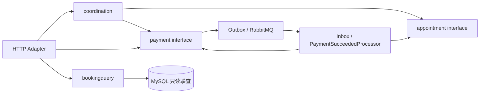

# 四模块代码设计与事务契约

本文对应四模块改造完成后的实现。业务结果见 [业务流程](business-flow.md)，HTTP 字段见 [API](api.md)，实测覆盖见 [验证报告](verification-report.md)。系统仍是一个 Spring Boot 应用、同一 MySQL，本轮没有数据库迁移或事件版本升级；Redis 仅作为本地依赖运行。

## 模块职责与入口

| 模块 | 拥有的知识 | 调用者使用的 interface |
| --- | --- | --- |
| appointment | 预约暂占、有效占用、库存、凭证快照、就诊序号 | `AppointmentHoldService`、`AppointmentCreationRequestService`、`AppointmentLifecycle` |
| payment | 支付单、尝试、通知验签与审计、退款、Outbox、渠道调用 | `PaymentOrderCreationService`、`PaymentAttemptService`、`PaymentNotificationIngress`、`PaymentLifecycle`、`PaymentRefundOperations`、`RefundWorker` |
| coordination | 同库创建、取消、过期、确认与对账的跨模块规则 | `BookingCoordinator`、`BookingLifecycleCoordinator`、`PaymentSucceededProcessor` |
| bookingquery | 预约/支付/最近尝试/退款的只读联查及响应 | `AppointmentService`（现有查询入口），由 `DefaultBookingQueryService` 实现 |

appointment 和 payment 写模块互不引用；coordination 使用稳定 application interface、业务事实和事件，不接触写模块 Mapper、Entity 或 implementation。HTTP Adapter 可以调用 coordination。bookingquery 可读取两侧数据及稳定类型，写模块不能反向依赖它。

## 主方法与内部规则

- [AppointmentHoldServiceImpl](../src/main/java/com/qsx/appoint/appointment/application/AppointmentHoldServiceImpl.java) 保留创建步骤，用 private 方法封装按需场次、占号、有效占用和快照构造。日期在实际占号前重新读取，不能只使用请求开始时的日期。
- [PaymentNotificationServiceImpl](../src/main/java/com/qsx/appoint/payment/application/PaymentNotificationServiceImpl.java) 表达幂等短路、锁定上下文、锁下复验、纯 Policy 决策、private execute。资金结果、通知审计、成功 Outbox 和必要迟到退款保持同一事务；不另开 Executor 事务。
- [BookingLifecyclePolicy](../src/main/java/com/qsx/appoint/coordination/application/BookingLifecyclePolicy.java) 只判断预约与支付组合事实，返回动作及关闭/退款原因，不读 Clock、数据库或渠道。Coordinator 保留归属校验、完整性、入口短路和事务顺序；事件 Processor 保留格式校验及 Inbox。
- [BookingWorkflowProjector](../src/main/java/com/qsx/appoint/bookingquery/application/BookingWorkflowProjector.java) 负责组合状态，`AppointmentResponseAssembler` 负责完整性、权限、脱敏及 DTO，查询主方法负责归属及一次列表时间采样。SQL、DTO 以及既有权限差异保持兼容。

纯 Policy 与单一内部 Assembler 不额外增加 interface。类型化的预约/支付状态和关闭/退款原因在 Java 层使用，持久化 Entity、Mapper、HTTP 和事件继续使用既有字符串；未知存储状态转为 `INTERNAL_ERROR`。

## 深生命周期 interface

[AppointmentLifecycle](../src/main/java/com/qsx/appoint/appointment/application/AppointmentLifecycle.java) 暴露 `find`、`lock`、`confirm`、`closePending`、`cancelConfirmed`。调用者只选择完整动作：

- `lock` 在内部按场次→预约加锁，返回 `AppointmentLifecycleCase`。
- `confirm` 在内部完成 held→confirmed、读取并递增下一就诊序号及确认预约，返回确认结果。
- `closePending` 释放暂占、按关闭原因置终态并删除有效占用。
- `cancelConfirmed` 释放已确认名额、取消并删除有效占用；序号不复用。

[PaymentLifecycle](../src/main/java/com/qsx/appoint/payment/application/PaymentLifecycle.java) 暴露 `find`、`lockByAppointment`、`closeUnpaid`，返回 `PaymentLifecycleCase`。关闭只推进支付单，不关闭 PROCESSING 支付尝试、不调用渠道；后续 PROCESSING+CLOSED 成功通知仍按迟到支付退款。

两种 Case 都是稳定事实，不暴露 Entity、库存或下一序号。`find` 是普通查询，其结果不能授权写入。锁方法和生命周期写方法使用 `Propagation.MANDATORY`：外层必须已有 Spring 事务，否则拒绝。写入只接受本事务 `lock` 返回的原对象；复制、伪造、上次事务缓存或传入 `REQUIRES_NEW` 均被拒绝。事务同步器维护身份上下文，随事务挂起/恢复并在完成后清理；一次写操作后须重新 lock 才能再写。

## 事务与锁序

| 用例 | 事务范围与顺序 |
| --- | --- |
| 创建 | `BookingCreationTransaction`：幂等登记→预约暂占→支付单→幂等回执，同库提交；两个创建写 interface 都要求 MANDATORY |
| 创建内部锁 | 统一设置→场次生成/锁定→就诊人锁定→最终日期复验及条件占号；失败回滚场次、库存、订单与幂等键 |
| 取消/过期/对账 | 外层 Coordinator 事务；先 `AppointmentLifecycle.lock`（场次→预约），再支付父记录，必要时退款子记录；Policy 不获取锁 |
| 成功事件 | Processor 事务：校验→Inbox登记→预约内部加锁→Policy→完整确认或关闭退款；不为普通确认重读支付单 |
| 尝试 T1/T2 | T1 payment→attempt，事务外调用渠道，T2 先只读定位再 payment→attempt，锁后复验关联 |
| 通知 | 先幂等只读短路；只读定位 attempt，再 payment→attempt→notification 复验；资金/审计/Outbox原子提交 |
| 退款请求/worker | 请求 payment→refund→成功attempt；worker claim、complete、fail 都先 payment 再子记录，渠道退款在两段本地事务之间 |
| 查询 | `DefaultBookingQueryService` 无写事务，不获取行锁；Mapper 只声明静态只读 SELECT |

只读定位用于找到父记录，不代替锁下复验。不能持有 payment 子记录再反向等待父记录，也不能在支付路径反向锁预约。条件 UPDATE 行数、唯一约束和 InnoDB 行锁仍是最终防线；应用 Policy 不代替数据库约束。

## 事件、重复与恢复

事件 envelope 保留 `eventId`、`eventType`、`eventVersion=1`、`aggregateId`、`occurredAt` 和 `payload`。`PaymentSucceeded` 的 aggregateId 是 paymentOrderId；payload 保留 paymentOrderId、appointmentOrderId、paymentAttemptId、providerTransactionNo、amount、currency、channel、paidAt。paidAt 是本系统确认渠道收款的服务端时间，不使用渠道 occurredAt 决定截止资格。

| 事件 | routing key | 业务队列 |
| --- | --- | --- |
| PaymentSucceeded v1 | `payment.succeeded.v1` | `appointment.payment-succeeded.v1` |
| RefundRequested v1 | `payment.refund.requested.v1` | `payment.refund-worker.v1` |
| RefundSucceeded / RefundFailed v1 | `payment.refund.succeeded.v1` / `payment.refund.failed.v1` | `notification.refund-result.v1` |

Outbox 发布到 `appoint.domain-events`，收到 Publisher Confirm 且无 mandatory return 才标记发布。消费者在数据库事务提交后 ACK；提交前失败全部回滚，提交后 ACK 丢失则重投命中 Inbox。事件和退款仍按至少一次投递设计。

支付成功处理首次加两次 TTL 重试合计三次，两次间隔一秒；永久无效消息直接 DLQ，耗尽也进入 DLQ。转发到 `appoint.domain-events.retry` 确认成功后才 ACK 原消息；失败 NACK/requeue。退款执行保留三次处理及渠道 refundNo 幂等。Broker 故障或确认不确定可带来额外投递，三次计数不构成绝对物理投递上限。

`DeadLetterReplayService.replayOne` 仅允许已登记 DLQ，原正文及 eventId 保持不变，重置对应重试计数和 TTL，确认目标发布成功后 ACK 原 DLQ 消息；没有开放 REST 重放接口。对账恢复截止前已支付待确认预约，或为已关闭已付预约确保退款；关联异常转人工项。不得删除 Inbox、生成新 eventId 绕过幂等或直接修改库存来补偿。

## 兼容边界与验证

旧 dev/test 同步模拟成功端点及 compat 支付尝试已删除，开发支付走真实 attempt→签名通知→Outbox→Inbox。正式 HTTP、schema V1–V9 与事件 v1 保持兼容。查询仍保留“到期待支付可取消”和“待确认已付 canCancel=false、写入口可取消退款”的历史差异。

[架构测试](../src/test/java/com/qsx/appoint/architecture/ModuleDependencyTest.java) 用生产依赖及故意违规 fixture 固定上述约束；静态 SQL 检查不是任意动态 SQL 的完整证明。接口行为用快速事务测试，锁/约束用 MySQL，传输及故障窗口用 RabbitMQ，实际 HTTP 链路用隔离 Compose；覆盖对照见 [baseline](../.scratch/booking-module-deepening/baseline.md)。
