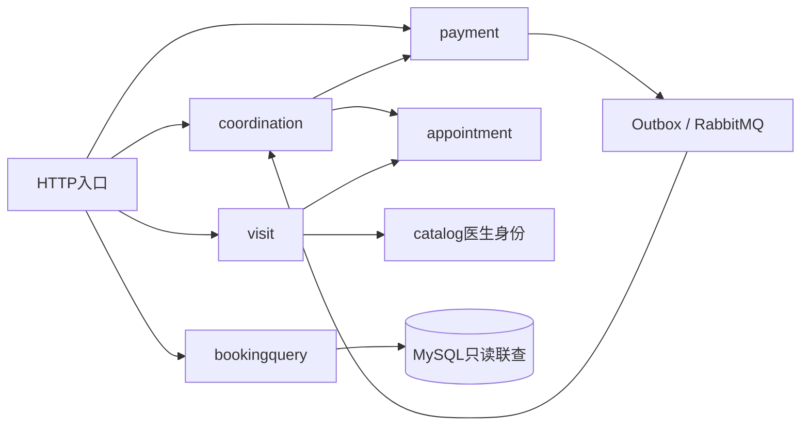

# 模块设计与维护

项目为单Spring Boot应用、单Maven工程的模块化单体，前端独立构建。MySQL保存业务事实，Flyway当前为V11；Redis只缓存目录，RabbitMQ用于支付后的可靠协调。业务规则见[业务流程](business-flow.md)，请求响应见[API](api.md)，设计原因见[ADR](adr/)。

## 模块职责与依赖

| 模块 | 负责内容 | 主要接口 |
| --- | --- | --- |
| auth / user / patient | 登录、角色和本人就诊人 | 认证与资料Service |
| catalog | 医疗目录、统一设置、场次查询、医生身份和目录缓存 | CatalogService、DoctorAccountService |
| appointment | 暂占、有效占用、库存、凭证和号码 | AppointmentHoldService、AppointmentLifecycle |
| payment | 支付单、尝试、验签、审计、退款、Outbox和渠道 | PaymentAttemptService、PaymentLifecycle、RefundWorker |
| coordination | 创建、取消、过期、支付确认和对账 | BookingCoordinator、BookingLifecycleCoordinator、PaymentSucceededProcessor |
| bookingquery | 用户详情和医生概览、名单、详情只读组合 | AppointmentService、DoctorVisitQueryService |
| visit | 签到、开始和完成接诊 | VisitService、VisitRules |
| localenv | 环境目标校验、实例锁、初始化及test调时 | LocalEnvironmentLifecycle |

appointment与payment写模块互不引用，coordination通过稳定应用接口和事实协调，不直接访问其他模块Mapper或Entity。bookingquery可以只读联查，写模块不反向依赖查询模块。Controller不直接访问Mapper。

## 数据关系

- `users`通过`user_roles`取得角色，`patients`归属于账号；`doctors.user_id`可空且唯一，首次绑定与DOCTOR授予同事务。
- `schedules`按医生、日期和场次类型唯一，保存库存、费用快照及下一号码。
- `appointment_orders`保存就诊凭证、支付截止和号码；`appointment_active_claims`约束同场有效占用，`appointment_create_requests`保存账号内幂等登记。
- `payment_orders`与预约一对一，关联支付尝试、通知审计、退款和Outbox；Inbox用于支付成功事件消费去重。
- `visit_records`与预约一对一，签到时创建，仅保存进度与时间。没有记录时查询推导待签到，查询不补写数据。

历史半日场次及终态继续读取，迁移不回填真实就诊结果。保留既有Flyway文件，新增结构由后续迁移演进。

## 创建与生命周期接口

[DefaultBookingCoordinator](../src/main/java/com/qsx/appoint/coordination/application/DefaultBookingCoordinator.java)规范化UUID幂等键和内容摘要，再调用独立Spring事务Bean `BookingCreationTransaction`。账号内幂等登记、按需场次、占号、预约、支付及回执同库提交。唯一键冲突退出事务并回滚后，外层才能查询已提交登记并返回重放回执。

[AppointmentHoldServiceImpl](../src/main/java/com/qsx/appoint/appointment/application/AppointmentHoldServiceImpl.java)在锁定设置、场次和就诊人后，实际占号前采样准入时间；Java与条件UPDATE使用同一时间复验日期和截止。预约与支付复制该创建时间及持久化支付截止。`BookingTimeRules`为目录与创建共享的纯规则，支付入口只使用已存截止。

`AppointmentLifecycle`暴露find、lock、confirm、closePending、cancelConfirmed；完整动作在内部维护库存、有效占用、号码及预约状态。`PaymentLifecycle`暴露find、lockByAppointment、closeUnpaid，关闭支付不调用渠道或自动关闭活跃attempt。

锁方法和生命周期写方法使用MANDATORY，要求已有Spring事务；写入只接受本事务lock取得的原事实对象。伪造、复制、跨事务缓存或传入REQUIRES_NEW均不能获取写授权；一次写后再次写须重新lock。find只供读取。

## 事务与锁序

| 用例 | 事务和锁序 |
| --- | --- |
| 创建 | 幂等登记→统一设置→生成/锁定场次→就诊人→准入复验及条件占号→预约与支付→回执 |
| 取消、过期、对账 | 外层协调事务；场次→预约→支付父记录→必要的退款子记录 |
| 支付成功事件 | Processor事务；校验→Inbox登记→预约内部加锁→确认或关闭退款；普通确认不重读支付单 |
| 支付尝试 | T1按payment→attempt创建本地记录，事务外调用渠道，T2再按父→子保存结果并复验 |
| 渠道通知 | 先只读定位，再payment→attempt→notification；资金、审计、Outbox同事务提交 |
| 退款 | 请求及worker均先支付父记录再子记录；claim、complete、fail为短事务，渠道调用在事务外 |
| 医生绑定 | 医生→用户；首次绑定与角色授予同事务 |
| 签到和接诊 | 各自本地事务，读取稳定预约事实，只写visit_records；唯一键及原状态条件更新保护首次时间 |
| 查询 | 只读联查，不获取行锁、不生成场次或就诊记录 |

只读定位不替代锁下复验。支付路径不反向锁预约，也不持有子记录再等待父记录。条件UPDATE行数、唯一约束和InnoDB锁是最终防线。

## 事件、重复与恢复

事件envelope固定为eventId、eventType、eventVersion、aggregateId、occurredAt、payload；当前版本v1。PaymentSucceeded以支付单ID为aggregateId，携带预约、attempt、渠道流水、金额、币种、渠道和paidAt。

| 事件 | routing key | 业务队列 |
| --- | --- | --- |
| PaymentSucceeded | payment.succeeded.v1 | appointment.payment-succeeded.v1 |
| RefundRequested | payment.refund.requested.v1 | payment.refund-worker.v1 |
| RefundSucceeded / RefundFailed | payment.refund.succeeded.v1 / payment.refund.failed.v1 | notification.refund-result.v1 |

Outbox随资金事务写库。`OutboxPublishTransaction`用FOR UPDATE SKIP LOCKED领取到期PENDING，持有本批锁发布。原eventId和payload保持不变，获Publisher Confirm且无mandatory return后标记PUBLISHED；它不表示消费者完成。发布失败耗尽为FAILED，当前发布器不自动领取FAILED。配置默认值见[application.yml](../src/main/resources/application.yml)。

支付成功消费者将Inbox、预约确认的库存与号码，或关闭释放与退款申请同事务提交，成功返回后ACK。提交前失败回滚，提交后ACK丢失导致重投，由Inbox及状态去重。

退款worker采用分段事务和原refundNo幂等。渠道可能已经成功而本地保存失败，重试仍用原退款号，不能推断整个监听调用失败代表渠道回滚。

支付成功与退款执行采用有界重试；支付成功为首次加两次TTL重试，每次间隔1秒，无效消息或耗尽进入DLQ。转发确认成功后才ACK原消息，失败NACK/requeue。至少一次投递可能产生额外物理重投，不承诺外部资金恰好一次。

退款结果队列已有拓扑但没有监听器；退款状态由worker落库，查询直接读取数据库，不代表短信邮件通知已实现。

## 就诊与查询

[DefaultVisitService](../src/main/java/com/qsx/appoint/visit/application/DefaultVisitService.java)通过AppointmentLifecycle读取稳定预约事实，通过catalog解析医生身份，只写本模块就诊记录。`VisitRules`由查询和写入共用，写入使用同一次秒精度采样完成资格判断与时间保存。校验顺序为不存在/归属→状态→开放→截止。

用户详情由`AppointmentResponseAssembler`组合预约、支付、退款和就诊；非确认预约的visit为null，已确认无记录推导NOT_CHECKED_IN。列表统一采样serverTime，展示资格不授予写权限。医生查询限定登录医生，四场补零、名单按号码升序，详情使用快照和脱敏资料，不返回用户支付渠道摘要。

## Redis目录缓存

[CatalogDirectoryCache](../src/main/java/com/qsx/appoint/catalog/cache/CatalogDirectoryCache.java)只缓存医院、科室、医生列表，前缀为`appoint:<namespace>:catalog:v1:`。医院及科室TTL默认5分钟，医生2分钟，空列表30秒；读取不续期，SET附带TTL。三环境namespace分别为dev/test/demo。

普通查询未命中时读取MySQL后回填；已在Spring事务内的查询绕过缓存，避免未提交数据进入共享缓存。目录管理事务提交后定向删除父列表：医院变更删除hospitals，科室变更删除所属医院departments，医生变更删除所属科室doctors；回滚不失效，账号绑定无需失效。

读连接错误时回源且本次不回填；损坏JSON回源并尝试覆盖；写入或失效错误不掩盖已取得的数据库结果或已提交的管理操作。MySQL错误继续传播，不伪装为空列表。缓存只保证最终一致性，提交后删除仍可能遇到在途旧值回填，由后续失效或TTL淘汰。

场次、设置、预约凭证、资金与就诊查询直接访问数据库。缓存可关闭；重新启用可使用新namespace或在停用期间清理旧前缀，避免复用旧值。地址、超时和开关见应用配置，Compose保留Redis卷和内存淘汰设置。

## 维护与恢复

| 情况 | 处理边界 |
| --- | --- |
| 迁移或启动失败 | 核对实际Flyway历史和部分DDL结果，保留记录、备份及数据；先查清再前向修复，不盲目repair或改旧迁移 |
| Broker故障 | 保留已提交资金事实，恢复连接和拓扑；PENDING可继续发布，PUBLISHED仍须核对消费结果 |
| Outbox FAILED | 核对原eventId、payload、last_error和业务事实，受控人工修复；它不是RabbitMQ死信，没有通用HTTP恢复入口 |
| 消费或退款重试失败 | 根据队列、eventId、refundNo定位；渠道可能已成功，保留原身份幂等续接 |
| DLQ | 修复原因后，通过已注入的DeadLetterReplayService.replayOne(ReplayTarget)受控重放；保留正文及eventId，确认转发后才ACK |
| 对账 | 定期恢复已付待确认及已关闭已付缺退款；长期尝试、Outbox、退款和关联异常部分仅报告人工项 |

DLQ重放只允许PAYMENT_SUCCEEDED、REFUND_REQUESTED、REFUND_RESULT逻辑目标，不接受任意物理队列。EMPTY表示未取到消息，REPLAYED只说明转发获确认；退款结果目标当前无消费者。对账不自动重置FAILED、不重放DLQ或查询渠道资金，也不修复历史库存。

保留Inbox、原消息身份和资金成功事实。已产生新模型数据后的应用回退必须确认schema及数据兼容；MySQL DDL不能假定整份迁移自动回滚。日常环境初始化与重置使用[正式入口](environments.md)，不通过删卷处理问题。
