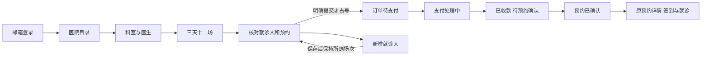

# 首版前端导航与完整页面设计稿

日期：2026-11-14（Asia/Shanghai）。本文保留页面设计与草图阶段记录；用户随后认可整体方案，并授权独立frontend/业务工程。当前开发取舍与进度见[实施方案](../frontend-implementation-plan.md)。本文下述“本轮”指当时草图阶段，不代表当前仍无Vue工程。

依据：[设计方向](frontend-experience-direction.md)、[参考调研](hospital-booking-ui-references.md)、[现行API](../api.md)、[就诊API](../visit/api.md)、[就诊需求](../visit/requirements.md)、[项目状态](../project-status.md)。本文的前端路径为设计建议，不表示已有页面或新增REST接口。

## 1. 本轮导航方案

预约挂号承担首页，不另设宣传门户。保留当前登录后访问目录的权限方式，统一使用邮箱与密码登录。注册只创建普通用户，不让用户勾选医生或管理员身份。

| 使用者 | 主要导航 | 账号入口 | 默认页面 |
| --- | --- | --- | --- |
| 普通用户 | 预约挂号、我的预约、就诊人 | 个人信息、退出登录 | 医院目录 |
| 医生 | 当日接诊；返回用户端 | 个人信息、退出登录 | 今天四场概览与当前场次名单 |
| 管理员 | 医院科室医生、统一预约设置、医生账号绑定；返回用户端 | 个人信息、退出登录 | 医疗目录维护 |

医生和管理入口按实际角色显示，服务端继续鉴权。草图为方便评审，可从页面选择器及标有“角色示例”的菜单直接切换，不代表普通用户有这些权限。退出登录在首版是清除客户端会话；后端当前没有JWT撤销接口。

电脑端：用户采用横向导航和限宽内容区；医生突出日期、场次、名单；管理员采用左侧菜单和右侧工作区。手机端：用户保留三个文字导航；管理菜单重排为顶部可换行按钮，不把整张宽表缩小。

## 2. 页面范围和接口对应

首版按14个页面模板设计。登录和注册共用模板；医院、科室、医生维护共用管理模板；新增/编辑表单、确认对话框不另外计为页面模板。

| 页面模板 / 建议路径 | 页面职责 | 已有接口能力 | 本轮草图 |
| --- | --- | --- | --- |
| 登录与注册 `/login`、`/register` | 邮箱、密码、注册后登录 | auth/register、auth/login | 已补齐，本地切换与表单演示 |
| 医院目录 `/booking` | 作为首页选择医院；按名称筛选当前已加载目录 | GET hospitals | 已补齐 |
| 科室医生 `/booking/hospitals/:id` | 明确医院上下文，先科室后医生 | 医院下科室、科室下医生GET | 已补齐，含无医生示例 |
| 日期场次 `/booking/doctors/:id` | 三天十二场、余号、费用、下单截止 | 医生schedules GET | 复用原草图，补入完整导航 |
| 核对预约 `/booking/confirm` | 选择就诊人，核对全部信息，明确提交 | patients GET、appointments POST | 已补齐独立页面 |
| 支付与结果 `/appointments/:id/payment` | 已创建订单的支付截止、支付尝试和确认进度 | payment attempts、dev/test MockPay、预约详情GET | 已补齐开发演示；含尝试失败 |
| 我的预约 `/appointments` | 全部预约，按就诊时间DESC/ASC排序 | appointments/my GET | 已补齐 |
| 预约详情 `/appointments/:id` | 凭证、支付退款、签到与就诊进度 | 详情GET、cancel、check-in | 复用原15种状态草图 |
| 就诊人 `/patients` | 新增、编辑、启用、停用 | patients POST/GET/PATCH、status PATCH | 已补齐，表单内联展示 |
| 个人信息 `/account` | 当前账号ID、邮箱、角色 | users/me GET | 已补齐只读页面 |
| 接诊工作台 `/doctor` | 日期、四场人数、固定号码名单、只读详情、开始/完成 | 五个医生接口 | 复用原草图 |
| 医疗目录 `/admin/catalog` | 医院→科室→医生逐级增改删 | 目录GET和九个admin目录写接口 | 已补齐三级表格与表单 |
| 统一设置 `/admin/booking-settings` | 容量和挂号费，提交前说明影响 | booking-settings GET/PUT | 已补齐 |
| 医生绑定 `/admin/doctor-accounts` | 指定医生档案和已存在账号ID，首次绑定 | doctor account PUT | 已补齐，本次回执不作为绑定查询 |

本轮不会加入独立数据大屏、全站用户管理、综合搜索、医院等级评分、真实扫码支付、改约、手工排班、停诊、病历处方、短信、找回密码或头像上传。这些未被已有接口覆盖；若之后提出，作为新增需求讨论。

## 3. 预约主流程

### 医院、科室与医生选择

- 首页不放新闻轮播、服务九宫格和虚构统计。医院条目只使用名称和地址。
- 名称筛选只处理当前已加载医院数组，控件明确范围；不呈现“按疾病找医生”等综合检索。
- 科室医生页保留面包屑和医院地址。电脑左侧科室、右侧医生；手机先科室按钮，再纵向医生卡片。
- 医生卡片展示姓名、职称、简介、医生编号；姓名首字作中性占位，不补评分、擅长标签或头像字段。
- 更换医院清除原科室、医生和场次；更换科室清除原医生和场次；更换医生重新选择场次。空数组解释为暂无下级资料，不擅自断言父级不存在。

### 核对预约

选中场次后的“下一步”进入独立核对页，替代原草图中的简短弹窗。电脑主区放就诊人和就诊安排，右侧放费用、取消规则与提交；手机按同一阅读顺序单列。

提交前应能回答：为谁、哪家医院、哪个科室哪位医生、哪天哪一场、当前费用、支付确认后的取消边界。启用就诊人才可选；没有可用就诊人时可新增或返回管理。新增保存后回到同一医生和场次，不让用户重新找号。

关键规则直接可见，并通过一次核对复选框确认。复选框仅表示确认信息和取消限制，不包装成未提供文本的法律协议。页面明确“提交前尚未占号”，按服务端创建结果处理余号和费用变化。

| 时间概念 | 何处显示 | 依据 |
| --- | --- | --- |
| 停止新下单 | 场次页说明、核对页具体时刻 | bookingClosesAt，开诊前15分钟 |
| 当前订单支付截止 | 创建后的支付页及预约详情 | 该订单paymentExpiresAt，不从新下单截止推导 |
| 到院首次签到窗口 | 核对页安排、已确认详情 | 开诊前30分钟起，场次结束时截止；正式详情使用visit字段 |

核对页展示的费用是当前查询值；订单创建后以金额与时间快照为准。实际实现保留同一次提交的幂等键，未知结果先核实原单；草图不实现真实并发、断网恢复或幂等机制。

### 支付与结果

支付是预约详情的子流程，不另建钱包。顶部始终说明当前预约是否已经确认，下方显示预约摘要、实际支付截止和可用动作。

开发演示页明确标注模拟支付：发起尝试→支付处理中→模拟渠道成功/失败→查看最新结果。通知受理不等于收款已处理，收款已确认也不等于预约已确认。草图将这些步骤演示为局部状态变化，正式对接必须通过详情GET读取事实；不按点击按钮直接宣告成功。

真实支付未接入，首版不能把MockPay当作生产可用结算渠道；prod没有可用渠道时展示实际不可用结果，不露出模拟按钮。支付失败后保留订单，取得最新资格后才允许重试；活跃处理中不重复发起。支付或退款轮询只在相关页面有限进行，离开后停止。

### 我的预约与详情

列表包含全部状态，默认按就诊时间DESC，可切换ASC，不把“最近待办优先”冒充服务端排序。卡片以预约日期场次、医院医生、就诊人、状态、序号和查看详情为主，不重复放齐所有操作。

详情沿用已评审的状态优先布局。关闭原因与退款进度并列，例如“已过期·退款中”。已确认取消须距开诊严格超过24小时；时间恰好24小时不允许。签到结束但未签到仍是已确认、待签到，不改成爽约或自动退款。号码是本场确认顺序，不作为前方人数、预计分钟或叫号状态。

## 4. 账号与就诊人表单

| 表单 | 必需字段和布局 | 关键反馈 |
| --- | --- | --- |
| 登录 | 邮箱、密码、密码可见切换；电脑左说明右表单，手机单列 | 账号或密码错误用统一文案；提交中防连点；失败保留邮箱 |
| 注册 | 邮箱、8–64字符密码 | 邮箱重复定位邮箱字段；成功后进入登录，不自动假定已有Token |
| 新增就诊人 | 姓名、固定居民身份证类型、完整证件号、电话、邮箱 | 五项必填；证件正式由服务端校验；重复登记保留输入 |
| 编辑就诊人 | 回填可读资料；证件只显示脱敏值 | 未改证件不传documentNo；选择更换后才要求重新输入原文 |
| 就诊人启停 | 姓名、现状、影响说明 | 停用限制后续新预约，不取消旧单；保留启用入口，不画删除 |
| 个人信息 | 账号ID、邮箱、角色只读 | ID可供管理员首次绑定；授权后重新登录 |

表单用字段旁文字说明错误；加载、提交中、失败重试、会话失效保持不同反馈。401返回登录时可保存不敏感的选择上下文，密码、完整证件原文不进入持久化草图状态。涉及真实前端的会话存储方案留到实现前确定。

## 5. 管理端设计

### 医疗目录维护

一个入口分为医院、科室、医生三个维护层级。科室显示所属医院；医生同时显示所属医院、科室。新增和编辑在当前表格区域呈现表单，避免连续叠加弹窗。

医院表单为名称和地址；科室只有名称；医生为姓名、职称和可选简介。医生编号系统生成且不可编辑，所属科室不提供更换。医生简介已有值时不能通过清空输入去清空后端字段，界面解释当前约束。

删除用确认对话框，服务端引用错误显示在当前上下文。不能承诺“级联删除全部数据”；即使当前没有预约，历史场次引用也可能拒绝删除。成功后重新查询受影响目录，失败保留行和当前层级。

### 统一预约设置

只保留每场容量、挂号费、只读CNY币种。保存前再展示新值和影响：仅影响之后首次生成的场次；已生成场次及订单保留原快照。不能写成“所有未来日期立刻生效”或提供后端没有的按医生覆盖设置。

### 医生账号首次绑定

先医院→科室→医生，再输入已存在的账号ID。核对时显示医生姓名、编号、目标账号ID以及不可解绑/换绑的限制。当前没有按ID查询他人账号或绑定关系的GET，因此不提供账号邮箱预览、全站账号搜索、绑定列表和刷新后已绑定状态。

成功只显示本次响应中的医生ID和账号ID；当前草图另保留选中医生姓名便于识别。账号不存在、已绑定等以实际接口错误反馈。刷新后不得把本地成功回执当服务端绑定查询结果；若以后确需绑定清单，要单独讨论新增查询契约。

## 6. 共用视觉和状态规范

- 三端共用品牌蓝、白/深色主题表面、约8–12px圆角、表单与焦点样式。用户端适度留白，医生及管理端增加信息密度；不增加装饰性大插画。
- 页面标题→当前任务/状态→核心资料→下一步的顺序稳定。用户端最终目标正文约16px，辅助约14px；当前草图为信息结构演示，尚未完成最终字号及对比度评审。
- 一个操作区突出一个主动作。危险动作通过明确对象和影响的确认对话框，不只靠红色提示。
- 正常、等待、失败均包含文字；加载不用空白冒充无数据。禁用说明保持可见，不只靠悬停。
- 所有输入有标签；原生按钮与表单支持键盘；提交错误提供文字提示，成功或状态变化可被辅助技术感知。

| 状态 | 页面行为 | 本轮草图覆盖边界 |
| --- | --- | --- |
| 正在加载 | 保留页面结构，隐藏不适用操作 | 文档定义，未模拟真实请求 |
| 真正无记录 / 无匹配 | 分别解释，并给新增或修改条件路径 | 医院无匹配、科室无医生、医生空场已演示 |
| 字段错误 | 字段旁报错，保留输入 | 原生表单校验、局部业务提示示例 |
| 提交中 / 请求结果未知 | 防连点，核实原请求结果 | 文档定义，不模拟完整网络时序 |
| 401 / 403 / 404 | 分别重新登录、无权访问、记录不可用 | 文档定义，未接真实权限 |
| 库存变化 / 时间截止 | 保留仍有效选择，刷新当前场次 | 文档定义，未接并发库存 |
| 支付中 / 待预约确认 / 退款中 | 分别显示并查询，不能提前成功 | 支付流程及15种详情状态已演示 |
| 管理引用冲突 | 保留资料，说明被引用无法删除 | 本地示例演示，不替代数据库约束 |

## 7. 手机重排

| 区域 | 电脑 | 手机 |
| --- | --- | --- |
| 医院目录 | 双列卡片 | 单列，完整名称和地址 |
| 科室医生 | 左科室、右医生 | 科室按钮换行，医生纵向卡片 |
| 日期场次 | 三日期同时比较 | 三日期切换，显示当天四场 |
| 核对预约 | 主要资料+右侧费用 | 就诊人→安排→费用规则→提交 |
| 就诊人表单 | 两列相关字段 | 单列，输入文字不缩小 |
| 管理目录 | 左菜单和表格 | 顶部菜单；行重排为有字段名的记录 |
| 医生详情 | 名单旁只读抽屉 | 独立只读视图，关闭恢复当前名单 |

原型容器在窄屏约560px以下重排，管理菜单在约750px以下移到上方；这些是草图的内容断点，不代表已冻结Vue/CSS实现。按钮触控尺寸以约44px为目标，最终需覆盖真实设备、键盘、中文长文本和主题对比度检查。

## 8. 评审与验证

完整流程草图在当前对话展示，原三张草图单独保留。资料和时间均为虚构示例，本地表单修改不保存到服务端；支付、绑定与维护均不执行真实业务。

本轮使用本地Chrome检查14个页面模板、15种详情状态，以及320、390、736、1024px容器中的整体溢出与内容边界。交互检查覆盖登录注册示例、无匹配医院、无医生科室、选择医生场次、新增就诊人返回核对、未核对禁提交、支付失败重试与确认、凭证资料快照、预约排序、管理删除引用提示、科室新增、设置保存核对和首次绑定回执。浏览器检查285条断言通过，无JavaScript错误。另人工检查电脑科室医生、核对预约、账号绑定及手机登录、目录维护、核对预约截图；发现手机核对费用区过挤后改为单列，并复查通过。这里只证明草图在所列检查中的表现，不代表真实权限、支付链路、身份证完整校验、并发、网络异常或可用性验收通过。

下一轮围绕此完整草图评审三件事：导航与完整页面范围是否合适；独立核对页和规则提示是否足够清楚；管理维护与手机信息密度是否舒适。再统一字号、颜色对比、组件交互及缺失错误示例，之后才进入Vue业务实现。

实现前仍需逐状态处理现有canCancel与写入口差异、角色更新后JWT重新登录、时间及金额DTO差异、前端会话存储等契约事项；本轮没有擅自改变后端规则。
