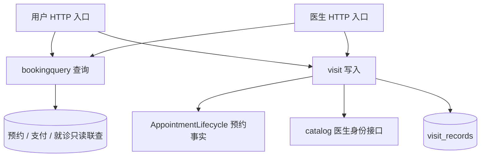

# 到院签到与门诊接诊设计

设计交付日期：2026-11-11；现行内容复核：2026-11-12。状态：已实现；源码包含 V10、就诊模块及本文接口。实际验证结果见 [验证报告](../verification-report.md)。

需求以 [就诊需求](requirements.md) 为准；请求响应见 [API](api.md)，实施范围及前后变化见 [改动说明](change-scope.md)。既有行为以 [现行模块设计](../module-design.md) 和 ADR 0003、0004、0005 为基础；公共预约目录与截止规则现按 [ADR 0007](../adr/0007-three-day-booking-and-session-cutoffs.md) 执行。

阅读顺序：先看[需求](requirements.md)，再看本页的职责、模型与契约，最后沿源码入口阅读实现。Java片段是契约说明，实际源码为准。

## 1. 模块分工与依赖

保持单 Spring Boot、单 Maven 和共享数据库。新增 `visit` 业务包，用户与医生看板共用就诊状态。

| 模块 | 本期职责 |
| --- | --- |
| `auth` / `user` | 沿用登录和 JWT；支持受控授予 `DOCTOR` 角色 |
| `catalog` | 医生档案新增登录账号关联；解析登录账号对应医生 |
| `appointment` | 保留预约、库存、快照、就诊序号；提供稳定预约事实 |
| `visit` | 签到、开始接诊、完成接诊，维护就诊记录 |
| `bookingquery` | 用户详情组合查询，以及医生概览、名单、详情只读查询 |
| `payment` / `coordination` | 保留既有收款、退款、预约确认和恢复职责 |



Controller 不访问 Mapper。`visit` 业务 Service 不依赖 `bookingquery`，不直接访问预约、支付或医生写 Mapper。查询模块允许只读联查业务表，不更新数据，也不因查看页面创建记录。

不为本期增加消息事件、消费者、定时任务、Redis 状态或通用工作流引擎。

## 2. 数据模型

### 2.1 医生账号

`doctors` 增加可空 `user_id`，关联已有账号并建立唯一约束：一个账号对应一个医生档案；现有医生在绑定前保留空值。继续复用现有 `roles` / `user_roles`，新增 `DOCTOR` 角色。

管理员绑定已有账号；普通注册继续只授予 `USER`。关联与授予角色在同一数据库事务中完成。首版不开发解绑、换绑和医生独立注册。用户授权后重新登录，现有 JWT 不动态变更角色。

### 2.2 就诊记录

已通过 Flyway 迁移 `V10__visit_workflow.sql` 新增 `visit_records`，未改写先前已执行的迁移。

| 字段 | 字段类型 | 约束及说明 |
| --- | --- | --- |
| `id` | BIGINT | 主键 |
| `appointment_order_id` | BIGINT | 非空、唯一，外键关联预约，保留历史不级联删除 |
| `status` | VARCHAR(32) | 非空，存储 `WAITING` / `IN_PROGRESS` / `COMPLETED` |
| `checked_in_at` | DATETIME | 非空，首次签到时创建记录 |
| `started_at` | DATETIME | 可空 |
| `completed_at` | DATETIME | 可空 |
| `created_at` | DATETIME | 非空 |
| `updated_at` | DATETIME | 非空 |

就诊记录不重复保存医院、科室、医生、就诊人快照或号码。就诊记录与预约一对一，通过预约定位场次和归属。

`NOT_CHECKED_IN` 是初始查询状态：仅当预约已确认且没有就诊记录时计算得出，不需要提前插入待签到记录。历史上没有记录仅说明系统没有记录该次签到，不证明实际未到院，不回填真实就诊结果。

## 3. 正常状态机与展示

| 事实 | 就诊记录 | 用户展示 |
| --- | --- | --- |
| 预约 `CONFIRMED`，无记录 | 不写库 | 已预约，待签到 |
| 用户签到 | 插入 `WAITING` 和签到时间 | 候诊中 |
| 医生开始接诊 | `WAITING` → `IN_PROGRESS`，保存开始时间 | 就诊中 |
| 医生完成接诊 | `IN_PROGRESS` → `COMPLETED`，保存完成时间 | 已就诊 |
| 其他预约状态 | 不生成待签到进度 | 保留原预约/支付展示 |

正常接诊不修改预约和支付状态。现有 `workflowStatus` 继续只表达预约与支付组合；用户端优先根据非空 `visit.status` 展示就诊文案，否则使用原流程展示。

共享 `VisitRules` 是小型纯规则类，不再增加 interface：

- 已确认、就诊日期等于服务端今天、无签到记录：允许签到。
- `WAITING`：允许开始接诊。
- `IN_PROGRESS`：允许完成接诊。

正常操作由医生一位一位接诊。本期不引入跨行忙碌状态、强制队首规则或精确到分钟的开诊资格。按钮矩阵只按当前行就诊状态计算；身份与归属在对应写入口确认。

签到按上海日期判断整天资格，不校验场次起止；医生动作没有额外的当天或场次时间要求。未签到、未完成记录不会被时钟推进自动改写。

全部业务时间复用现有 `appointmentClock`（`Asia/Shanghai`）。一次列表统一采样时间，查询标记与写入共用同样的日期规则；写入时重新判断正常操作资格。

## 4. Service 契约

以下是已实现的接口形状。接口返回 DTO 或稳定业务事实，不返回 Entity。

### 4.1 用户预约查询：扩展已有契约

```java
public interface AppointmentService {
    // 保留旧签名，使用默认 DESC，兼容已有调用者。
    List<AppointmentResponse> listMine(Long userId);

    List<AppointmentResponse> listMine(
            Long userId, AppointmentTimeOrder order);

    AppointmentResponse getOwned(Long userId, Long appointmentId);
}

public enum AppointmentTimeOrder { ASC, DESC }
```

仍由 `bookingquery.application.DefaultBookingQueryService` 实现。旧签名保留，但默认列表顺序有意从 ID 降序调整为就诊日期、开始时间、ID 降序；兼容影响见改动说明。Mapper 使用两个固定排序分支，不拼接客户端传入的 SQL。

### 4.2 就诊写入：新增 `VisitService`

```java
public interface VisitService {
    void checkIn(Long userId, Long appointmentId);
    void startVisit(Long doctorUserId, Long appointmentId);
    void completeVisit(Long doctorUserId, Long appointmentId);
}
```

| 方法 | 正常执行步骤 |
| --- | --- |
| `checkIn` | 读取预约事实 → 确认账号归属、已确认、当天、待签到 → 插入候诊记录和时间 |
| `startVisit` | 解析医生身份 → 确认预约所属医生、候诊状态 → 更新就诊中和开始时间 |
| `completeVisit` | 解析医生身份 → 确认预约所属医生、就诊中状态 → 更新已就诊和完成时间 |

三个方法由 `DefaultVisitService` 实现，分别使用普通 `@Transactional` 同步提交。它们只写就诊表，不调用释放库存或取消退款方法。

预约事实通过 `AppointmentLifecycle.find()`读取。`AppointmentLifecycleCase`已包含`doctorId`，由`DefaultAppointmentLifecycle`从预约快照映射，生产构造点和测试数据已同步。该字段只用于归属校验，不授予预约生命周期写入权限。

### 4.3 医生只读查询

```java
public interface DoctorVisitQueryService {
    List<DoctorSessionResponse> listSessions(
            Long doctorUserId, LocalDate date);

    List<DoctorAppointmentRowResponse> listAppointments(
            Long doctorUserId, LocalDate date,
            AppointmentSession sessionType);

    DoctorAppointmentDetailResponse getAppointment(
            Long doctorUserId, Long appointmentId);
}
```

实现归属 `bookingquery`。查询先从登录身份解析医生 ID，再限定该医生的数据；不接受客户端任意指定医生。

概览组合固定四场和实际预约统计，不要求场次行预先存在。名单只读已确认预约及其就诊进度，按 `visit_number ASC`；不按状态或签到时间重排。详情从预约快照获取资料，证件号在响应组装时脱敏。

### 4.4 医生身份准备

`catalog.service.DoctorAccountService`已实现以下契约：

```java
DoctorAccountResponse bindAccount(Long doctorId, Long userId);
Long requireDoctorId(Long userId);
```

绑定方法作为同库事务入口，写本模块医生关联，通过 `user` 模块新增的内部 `UserRoleService.grantDoctorRole(userId)` 确认账号并授予角色；不跨模块访问用户 Mapper。`requireDoctorId` 供 `visit` 和医生查询使用，仅返回 ID。

这两个职责分别留在医生档案和用户角色的拥有模块，不迁移既有医生目录或身份数据。

## 5. HTTP 与查询组装

### 5.1 签到入口

`visit.controller.UserVisitController` 映射 `/api/v1/appointments/{appointmentId}/check-in`。URL 使用预约标识，不要求 Controller 放进预约业务包。

```java
Long userId = (Long) authentication.getPrincipal();
visitService.checkIn(userId, appointmentId);
return Result.success(appointmentService.getOwned(userId, appointmentId));
```

签到事务提交后，HTTP 入口查询最新详情返回；`VisitService` 本身不反向调用页面查询。用户不提交账号 ID、状态或签到时间。

### 5.2 用户返回结构

现有 `AppointmentResponse` 增加可空 `AppointmentVisitResponse visit`，并补充可空 `sessionType` 供页面显示场次标签。新响应类型放在 `appointment.dto`，仅持有 String、时间和布尔值，避免预约契约反向依赖 `visit` 实现。

```java
public record AppointmentVisitResponse(
        String status,
        LocalDateTime checkedInAt,
        LocalDateTime startedAt,
        LocalDateTime completedAt,
        boolean canCheckIn) {}
```

`BookingQueryMapper` 增加对 `visit_records` 的 LEFT JOIN，并读取关联场次的 `session_type`；`BookingQueryRecord` 增加相应字段，`AppointmentResponseAssembler` 结合预约状态与统一时间组装上述对象。日期和起止时间仍取预约快照，历史空或旧场次类型继续可读。已有取消接口返回 `AppointmentResponse`，因此也带上新增字段；创建接口使用独立的 `AppointmentCreationResult`，响应结构保持原样。

医生详情使用自己的 DTO，只有预约与就诊所需资料，不复用携带支付渠道摘要的用户完整响应。医生开始/完成返回更新后的医生详情，前端随后重新查询名单，更新按钮与统计。

## 6. 源码阅读与并发保障

| 内容 | 实际入口 | 阅读重点 |
| --- | --- | --- |
| 数据库 | [V10](../../src/main/resources/db/migration/V10__visit_workflow.sql) | 账号关联唯一、预约与就诊一对一、状态及时间约束 |
| 写入 | [DefaultVisitService](../../src/main/java/com/qsx/appoint/visit/application/DefaultVisitService.java) | 每个动作本地事务；归属、确认状态、进度判断 |
| 条件更新 | [VisitRecordMapper](../../src/main/java/com/qsx/appoint/visit/mapper/VisitRecordMapper.java) | 首次插入唯一约束、WAITING→IN_PROGRESS→COMPLETED条件更新 |
| 共享规则 | [VisitRules](../../src/main/java/com/qsx/appoint/visit/domain/VisitRules.java) | 当天签到，按当前进度判断医生动作 |
| 用户查询 | [AppointmentResponseAssembler](../../src/main/java/com/qsx/appoint/bookingquery/application/AppointmentResponseAssembler.java) | 非确认visit为null；无记录推导待签到 |
| 医生查询 | [DefaultDoctorVisitQueryService](../../src/main/java/com/qsx/appoint/bookingquery/application/DefaultDoctorVisitQueryService.java)、[Mapper](../../src/main/java/com/qsx/appoint/bookingquery/persistence/DoctorVisitQueryMapper.java) | 登录医生范围、四场补零、号码顺序、快照与脱敏 |

visit只通过预约稳定接口读取事实，不写预约、支付或库存。账号首次绑定按医生→用户加锁，同事务增加DOCTOR角色；唯一约束防止一账号绑定多个医生，授权后重新登录。

重复或并发动作返回状态冲突，保留首次时间；不强制队首、不增加跨行忙碌限制、不按时间自动结束。就诊完成不释放号源。查询和写入共用VisitRules，名单固定按visitNumber升序。

## 7. 返回契约

以下record字段与源码保持一致；HTTP语义见[就诊API](api.md)。

```java
public record AppointmentVisitResponse(
        String status,
        LocalDateTime checkedInAt,
        LocalDateTime startedAt,
        LocalDateTime completedAt,
        boolean canCheckIn) {}
```

```java
public record DoctorSessionResponse(
        LocalDate appointmentDate,
        String sessionType,
        LocalTime startTime,
        LocalTime endTime,
        int confirmedCount,
        int notCheckedInCount,
        int waitingCount,
        int inProgressCount,
        int completedCount) {}
```

```java
public record DoctorAppointmentRowResponse(
        Long appointmentId,
        Integer visitNumber,
        String patientName,
        String visitStatus,
        LocalDateTime checkedInAt,
        boolean canStartVisit,
        boolean canCompleteVisit) {}
```

```java
public record DoctorVisitProgressResponse(
        String status,
        LocalDateTime checkedInAt,
        LocalDateTime startedAt,
        LocalDateTime completedAt) {}
```

```java
public record DoctorPatientResponse(
        Long id,
        String name,
        String documentType,
        String documentNoMasked) {}
```

```java
public record DoctorAppointmentDetailResponse(
        Long appointmentId,
        String appointmentNo,
        Integer visitNumber,
        LocalDate appointmentDate,
        String sessionType,
        LocalTime startTime,
        LocalTime endTime,
        DoctorPatientResponse patient,
        AppointmentDoctorResponse doctor,
        DoctorVisitProgressResponse visit) {}
```

## 8. 验证与演进

当前测试入口见[场景覆盖](../testing/scenario-coverage.md)，历史实施SQL、DTO来源表、逐文件改动和阶段验证见[就诊档案](requirements.md)。原有预约、资金和库存规则见[业务流程](../business-flow.md)。
